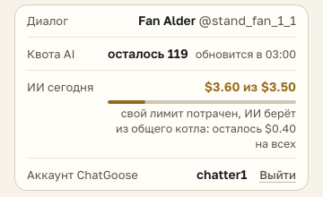

# Свой лимит ИИ кончился: дальше ИИ берёт из общего котла команды

Всё, что команда недотратила вчера из своих лимитов ИИ, складывается в общий котёл на сегодня. Когда ваш лимит кончился, ИИ не выключается, а берёт из котла, пока там есть деньги:

- на полосе ChatGoose вместо «ИИ $3.60 / $3.50» жёлтое «ИИ котёл $0.40»: столько осталось в котле на всех;
- всплывает «Свой лимит ИИ на сегодня кончился» с остатком котла;
- в окне расширения под строкой «ИИ сегодня» видно, сколько в котле.

Котёл общий: из него тратят все, у кого кончился свой лимит. Когда пусты и лимит, и котёл, полоса красная, «ИИ до 00:00», и ИИ не работает до 00:00 по Москве.

## Как это устроено

Котёл на день по Москве: сумма того, что каждый с лимитом не потратил из своего лимита вчера. Дальше одного дня он не копится. Хаб пускает генерацию, пока у человека есть остаток своего лимита или в котле есть деньги, и отказывает (CG-AI-LIMIT с отсчётом до 00:00 МСК), только когда пусто и там, и там. Расширение берёт остаток котла из того же ответа хаба, что и лимит: при запуске, раз в 5 минут и через 3 секунды после каждой генерации, так что цифра на полосе может отставать на несколько минут от трат других. Предупреждения по-прежнему по одному разу за день: на 80 % своего лимита, когда начался котёл и когда кончилось всё.
