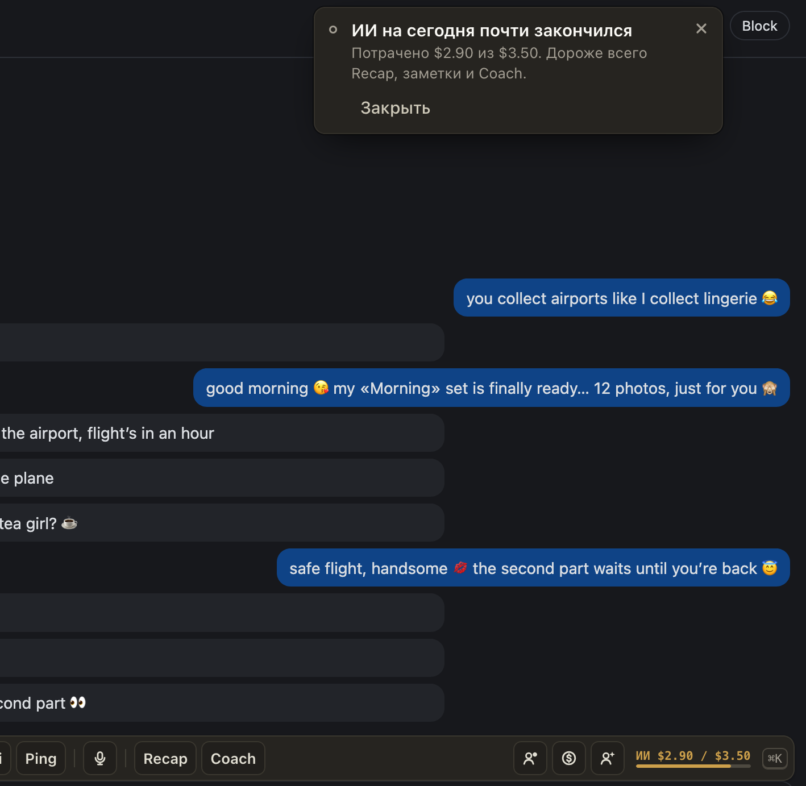
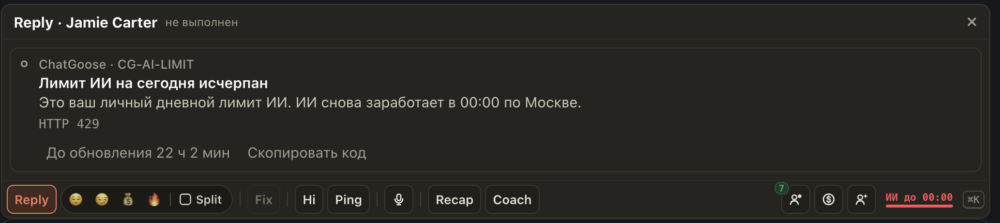
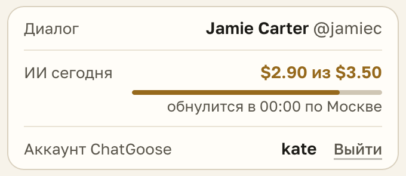

# Ваш дневной лимит ИИ виден на полосе ChatGoose и в окне расширения

Владелец задаёт каждому свой лимит на ИИ в день. Теперь его видно прямо за работой:

- справа на полосе ChatGoose: «ИИ $2.90 / $3.50» с полоской. С 80 % она жёлтая, а когда лимит закончился, красная: «ИИ до 00:00»;
- в окне расширения строка «ИИ сегодня»: сколько потрачено, сколько можно и когда обнулится;
- на 80 % всплывает «ИИ на сегодня почти закончился», на 100 % «Лимит ИИ на сегодня исчерпан». Каждое предупреждение один раз за день.

Когда лимит исчерпан, Reply, Fix, Hi, Ping, Recap и Coach не работают до 00:00 по Москве. Дороже всего Recap, заметки и Coach: если до конца смены далеко, их лучше беречь.

## Как это устроено

Лимит задаёт владелец в кабинете хаба, он считается за день по Москве по всем страницам вместе. Расширение спрашивает у хаба лимит и траты за сегодня при запуске, раз в 5 минут и через 3 секунды после каждой генерации (цена ответа известна хабу только после него). Без лимита полоски и строки нет. Отказ хаба на лимите: код CG-AI-LIMIT с отсчётом до 00:00 МСК, а не до 03:00, как у общей дневной квоты.
