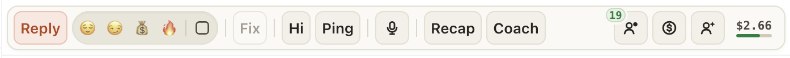

# Панель над полем ввода снова помещается целиком, вместе с лимитом ИИ

С лимитом ИИ справа на панели ряд стал шире, и в нешироком окне (например, Fansly на ноутбуке) лимит
уезжал за край: его было видно только наполовину.

Теперь лимит без лишних слов, только цифры: «$2.66 / $4.00», сколько потрачено за сегодня и из скольких.
Если места мало, остаётся «$2.66», а какая это часть лимита, видно по полоске под цифрой. Наведите на цифры:
в подсказке всё словами, с остатком и котлом. Когда свой лимит кончился, там «котёл $18.40», когда
потрачено всё, красное «до 00:00». Если окно ещё уже, Recap и Coach, как и раньше, становятся иконками.

## Как это устроено

Панель сворачивается по своей ширине: ниже каждого порога кнопки сжимаются, потом Recap и Coach становятся
иконками, потом пропадают разделители. Пороги были посчитаны до лимита ИИ, а «ИИ $2.66 / $4.00» добавил к
ряду около 117 px. Теперь слова «ИИ» нет, лимит занимает около 98 px, коротко около 48 px, и у панели с
лимитом свои пороги, пересчитанные на обоих сайтах: лимит целиком виден от ~750 px, все слова на панели
от ~665 px, и ряд не прокручивается до ~450 px. У кого лимита нет, панель сворачивается как раньше.
