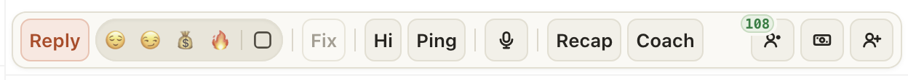

# Панель над полем ввода снова помещается целиком, вместе с «Онлайн»

С кнопкой «Онлайн» панель стала шире, и в нешироком окне (например, Fansly на ноутбуке) последние кнопки
уезжали за край: «Новые» или Spenders приходилось искать прокруткой.

Теперь число фанов онлайн стоит зелёным значком в углу иконки «Онлайн», как остаток ответов у Reply, а
кнопка занимает столько же места, сколько Spenders и «Новые». На обычном окне Fansly все кнопки и все
слова снова на виду. Если окно ещё уже, Recap и Coach, как и раньше, становятся иконками, а их названия
остаются в подсказке.

## Как это устроено

Панель сворачивается по ширине самой панели: ниже каждого порога кнопки сжимаются, потом Recap и Coach
становятся иконками, потом пропадают разделители. Пороги были посчитаны до «Онлайн», а кнопка «Онлайн N»
добавила к ряду около 60 px. Теперь число лежит поверх угла иконки и не меняет ширину кнопки, будь там
5 или 108 фанов, а пороги пересчитаны на обоих сайтах с новой кнопкой: все слова видны на панели от
~595 px, ряд не прокручивается до ~515 px.
