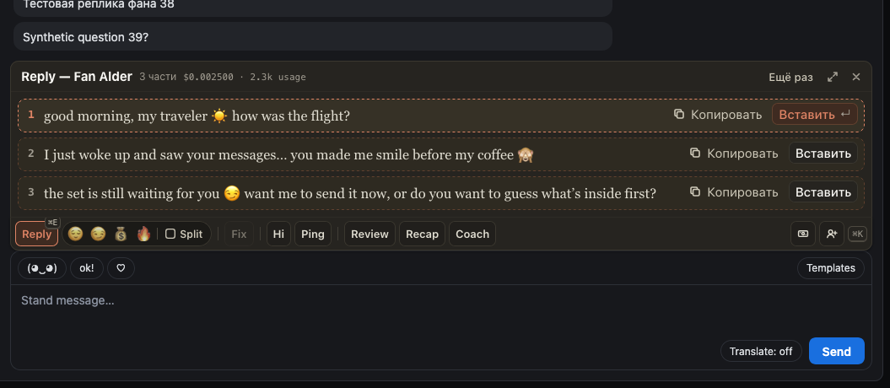
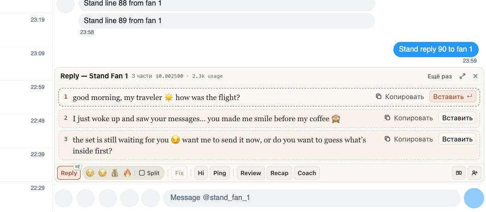

# ChatGoose 3.0 — одно расширение для ChatSpace и Fansly

Старое расширение для Fansly и ChatGoose для ChatSpace стали одним расширением. На обоих сайтах те же
кнопки, клавиши и окна: Reply, Fix, Hi, Ping, Recap, Review, Coach, Spenders и «Новые», а на Fansly ещё
заметки и загрузка в волт. Новое и исправления теперь приходят сразу на оба сайта.

Чаттерам ChatSpace делать ничего не нужно: расширение обновится само. Чаттерам Fansly нужно один раз
перейти со старого расширения — это несколько минут, порядок ниже.

Пока нет войсов на Fansly: они появятся в одном из следующих обновлений.

## Как это устроено

Номер 3.0 продолжает версии старого расширения для Fansly (последняя — 2.13), а ChatSpace переходит на
него с 0.5. Старое расширение больше не обновляется. Ответы AI, персоны и данные страниц по-прежнему идут
через хаб ChatGoose, вход — тем же логином, что в приложении ChatGoose. Код один на оба сайта: у каждого
сайта свой адаптер к странице, а окна, кнопки и клавиши общие.
