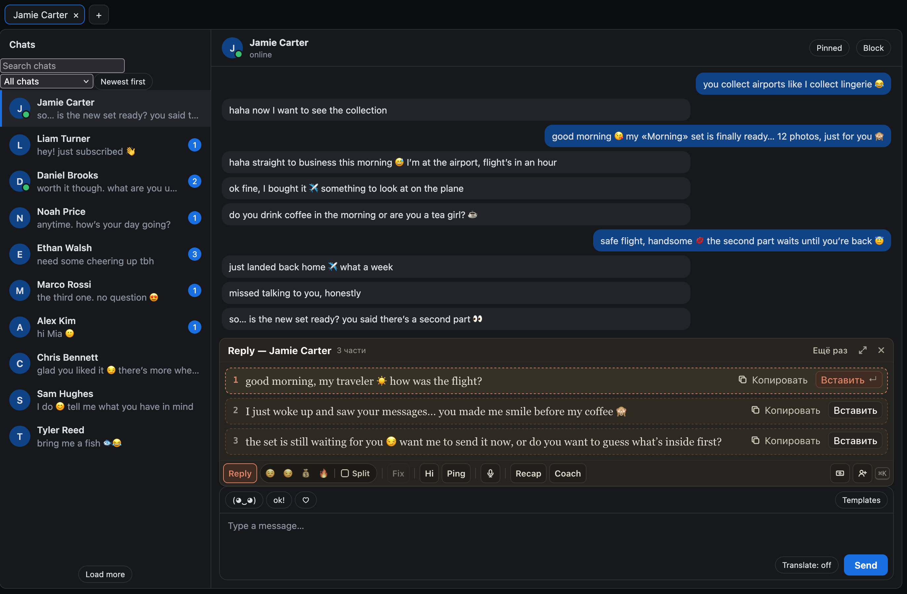
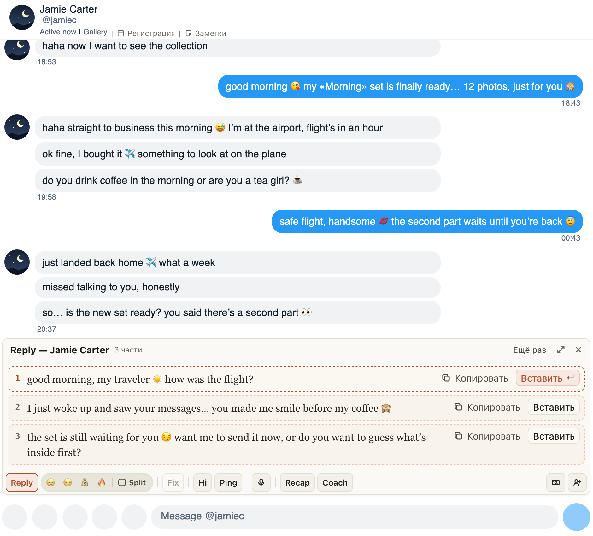
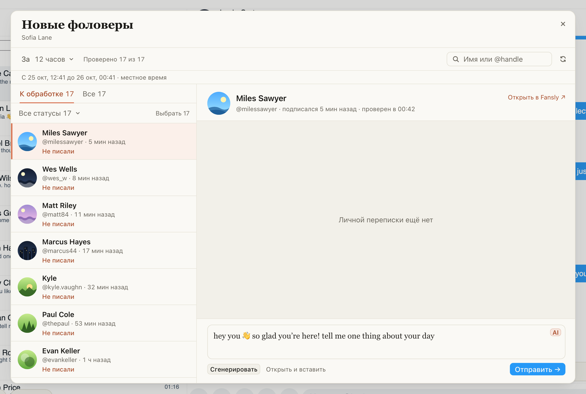

# ChatGoose 3.0: одно расширение для OnlyFans и Fansly

Расширение для Fansly, расширение для ChatSpace и приложение ChatGoose Desktop стали одним расширением для
Firefox. На OnlyFans и Fansly у него одна панель, одни клавиши и одни окна, а новое теперь приходит сразу на оба
сайта.

Reply, Fix, Hi и Ping над полем ввода, Coach с Recap и Review, Spenders и «Новые» на месте и работают как
раньше. Ниже рассказываем, что появилось нового.

Если ChatGoose у вас уже стоит, версия 3.0 придёт сама в течение дня. Если ещё работает старое расширение для
Fansly (2.x) или Desktop, их можно удалить: как перейти, написано в конце.

Сайт тоже один: [chatgoose.gosling-agency.ru](https://chatgoose.gosling-agency.ru/). Там установка, руководство
и что нового.

## Как это устроено

Номер 3.0 продолжает версии старого расширения для Fansly (последней была 2.14), а ChatGoose для ChatSpace
переходит на него с 0.10. Код один на оба сайта: у каждого сайта свой адаптер к странице, а окна, кнопки и
клавиши общие. Ответы ИИ, персоны и данные страниц идут через хаб ChatGoose, вход по тому же логину.
