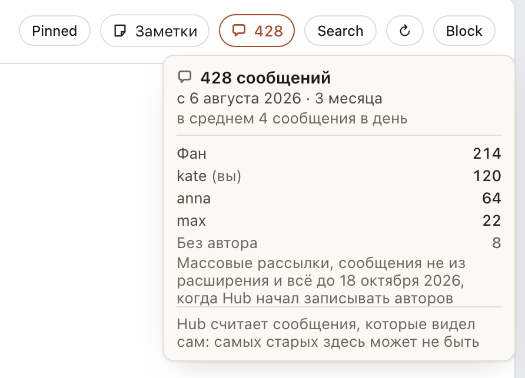

# В шапке чата на OnlyFans видно, сколько сообщений с фаном и кто сколько написал

Тот же значок, что на Fansly, теперь в ChatSpace: в шапке чата сразу после «Заметок» стоит «💬 428», столько
сообщений было в этом чате. Наведите на него: в карточке с какого дня идёт переписка, сколько сообщений в среднем
в день или в неделю, сколько написал фан и сколько каждый чаттер (ваша строка помечена «(вы)»). Так сразу видно,
давно ли вы общаетесь с фаном и кто из команды его вёл.

На OnlyFans эти числа считает Hub по сообщениям, которые видел сам, поэтому самых старых в них может не быть: об этом
говорит последняя строка карточки. «Без автора» здесь: массовые рассылки, сообщения не из расширения и всё до
18 октября 2026. Если Hub не видел ни одного сообщения чата, значка нет.

## Как это устроено

Значок и карточка те же, что на Fansly. При открытии чата расширение один раз спрашивает Hub тем же запросом, что на
Fansly, только вместо чата называет фана (на OnlyFans чат и есть фан), и помнит ответ, пока открыта вкладка: чат,
открытый снова, показывает значок сразу. К ChatSpace, OnlyMonster и OnlyFans за этим не ходим, историю чата не
читаем, прочитанным ничего не отмечается. Hub не может доказать, что дошёл до самого первого сообщения чата на
OnlyFans, поэтому число, дата начала и разбивка: то, что есть в его архиве, на деле всё с тех пор, как он начал
сохранять страницу. Сообщения чаттеров он считает по записям об отправке, которые расширение делает на OnlyFans с
18 октября 2026. Пока ответа нет или запрос не удался, значка тоже нет.
