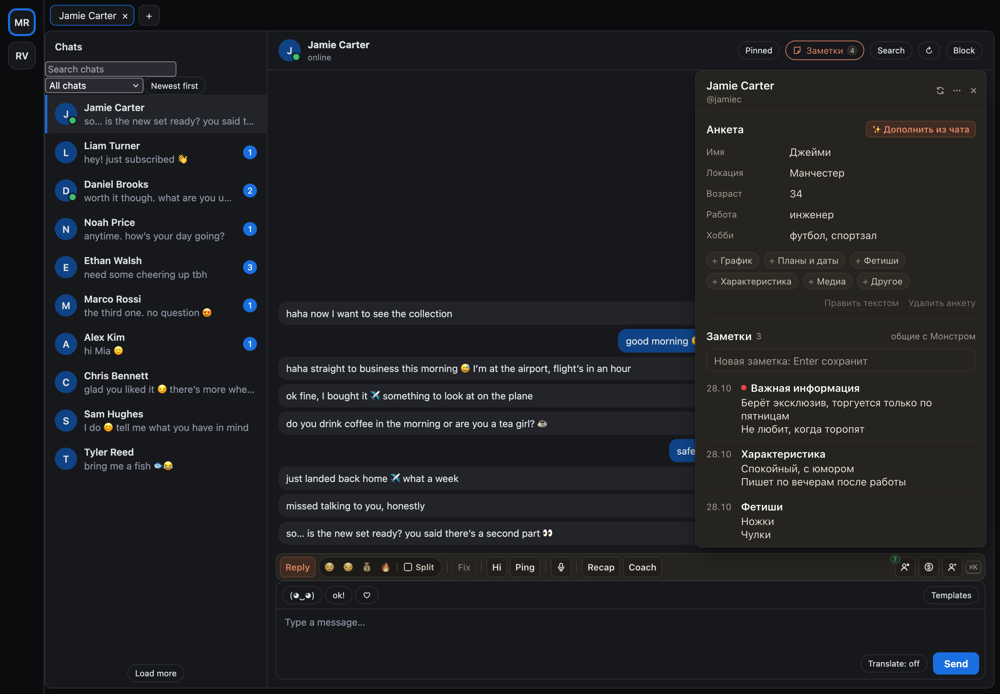
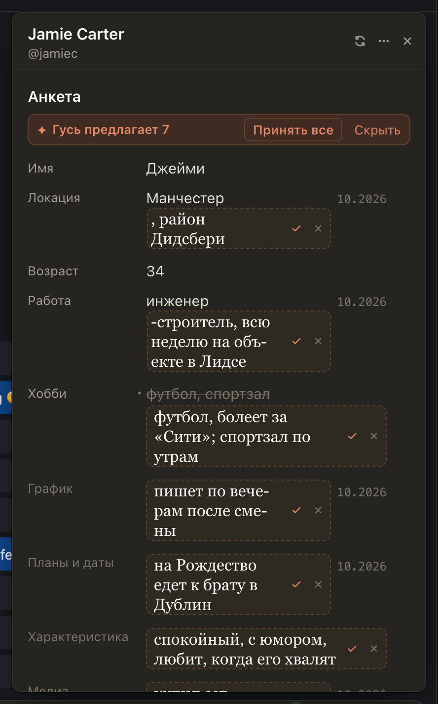

# «Заметки» на OnlyFans: анкета фана и «Заполнить из чата»

Те же «Заметки», что на Fansly, теперь в ChatSpace. Кнопка «Заметки» стоит в шапке чата рядом с поиском, окно
открывается и по ⌘⇧K (Ctrl+Alt+K). В нём анкета фана таблицей из 11 полей: поле правится прямо в строке, Enter
сохраняет. «✨ Заполнить из чата» читает переписку и предлагает новое прямо в строках анкеты, в заметки попадает
только то, что вы примете ✓. Ниже быстрая заметка (строка и Enter, подписана вашим логином) и все заметки фана.

Это те же заметки, что во вкладке «Заметки» справа в ChatSpace: команда видит их и там, и здесь. Разделы, которые
команда уже ведёт в Монстре («Важная информация», «Фетиши» и другие), стоят в списке как были.

## Как это устроено

Заметки хранятся в самом OnlyMonster, в заметках фана. Расширение читает и пишет их через вашу сессию ChatSpace,
только по вашему нажатию и только для фана открытого чата. Перед правкой заметка перечитывается: если её успел
изменить коллега, вы увидите его версию и решите сами, молча ничего не затирается. Анкета это одна заметка с
заголовком «Анкета» и строками «Поле: значение». «Заполнить из чата» читает переписку в хабе (от 3000 сообщений) и
отправляет в хаб только названия полей и их значения. Владелец включает «Заметки» для каждой страницы отдельно.
