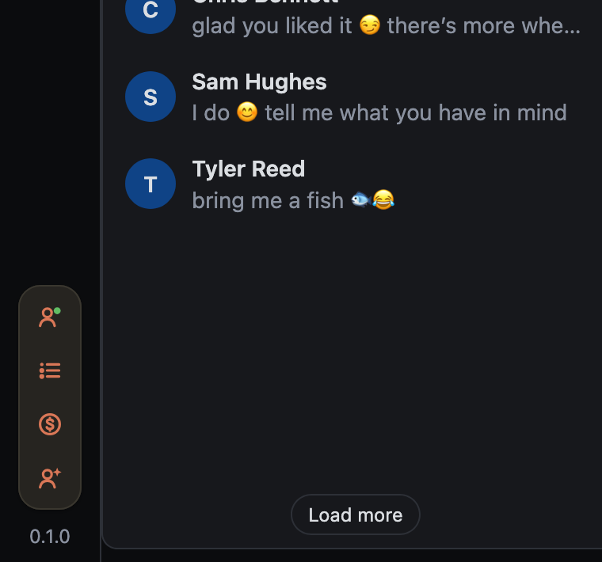

# В ChatSpace кнопки «Онлайн», «Очереди», Spenders и «Новые» внизу колонки аккаунтов

На Fansly эти доски открываются из карточки в левом нижнем углу страницы. Теперь такая же карточка есть в ChatSpace:
внизу левой колонки с аккаунтами, прямо над номером версии. Четыре значка сверху вниз: «Онлайн», «Очереди», Spenders
и «Новые». Один клик открывает доску с любой страницы ChatSpace, даже когда чат не открыт; раньше вне чата их
открывали только из меню расширения или клавишами.

Подписей у значков нет: наведите курсор, и подсказка скажет, что это за доска и какая у неё клавиша (Spenders ⌘⇧M,
«Новые» ⌘⇧U, вне Mac Ctrl+Alt+M и Ctrl+Alt+U).

## Как это устроено

Кнопки те же, что на Fansly: те же значки, подсказки и порядок, только карточка узкая и без подписей. Она стоит в
самой колонке ChatSpace, а не поверх страницы: плитки аккаунтов и круглый «+» остаются на своих местах, а в низком
окне плитки прокручиваются, как ChatSpace делает сам, когда аккаунтов много. Если колонки на странице нет или она
устроена не так, как ожидает расширение, карточки нет. Первый клик подгружает основную часть расширения (пока она
грузится, значок на нажатой кнопке мерцает) и открывает доску, дальше доски открываются сразу. Цвет карточки сначала
следует теме ChatSpace, а после загрузки расширения его настройке «Тема».
