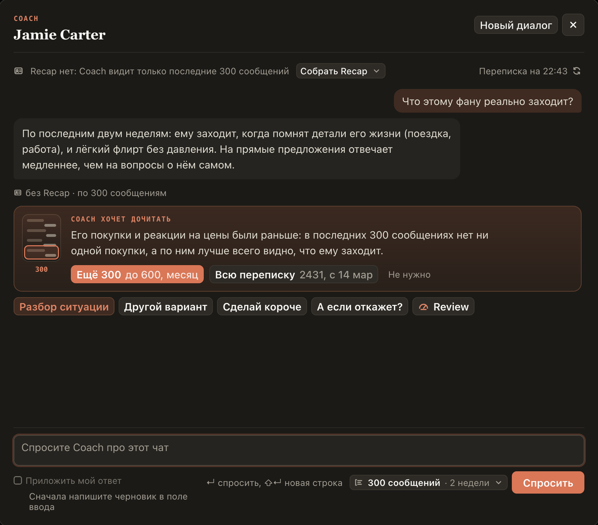
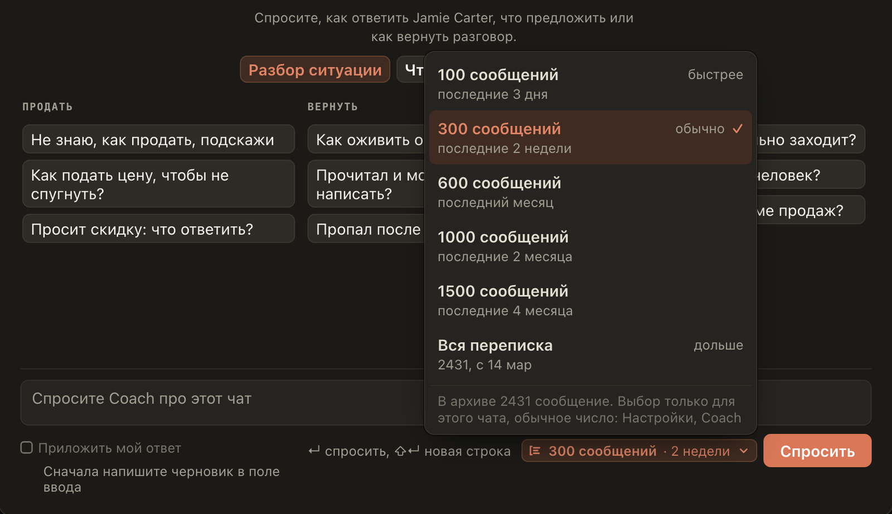

# Coach читает 300 сообщений и сам просит дочитать, если ему мало

Раньше Coach видел только последние 100 сообщений чата и мог не знать, что фан покупал раньше или что ему обещали.
Теперь он читает 300, а рядом с «Спросить» видно, сколько это: «300 сообщений · 2 недели». Нажмите на эту кнопку,
чтобы для этого чата выбрать 100, 600, 1000, 1500 сообщений или всю переписку: у каждого варианта написано, за
какой срок.

Если для ответа нужна история постарше, Coach скажет об этом сам. Под ответом появится «Coach хочет дочитать»: что
он не видит и почему это важно, и два варианта, оптимальный (например, «Ещё 300») и полный («Всю переписку»).
Нажмите, и Coach ответит на тот же вопрос заново, прочитав больше. Если не нужно, нажмите «Не нужно».

## Как это устроено

Coach читает переписку из архива хаба: чем больше сообщений, тем дольше ответ, поэтому всю переписку он читает только
по вашему выбору, до 3000 сообщений за раз. Сколько сообщений в архиве и за какой срок, Coach узнаёт, когда вы
открываете его окно. Просьбу дочитать пишет сама модель: хаб говорит ей, сколько сообщений она видит и есть ли в
архиве старше, и она добавляет просьбу, только если старые сообщения изменят совет. Выбор для чата держится до
перезагрузки вкладки. Обычное число меняется в настройках: «Генерация», Coach, «Сколько читает Coach». Recap Coach
учитывает, как и раньше.
