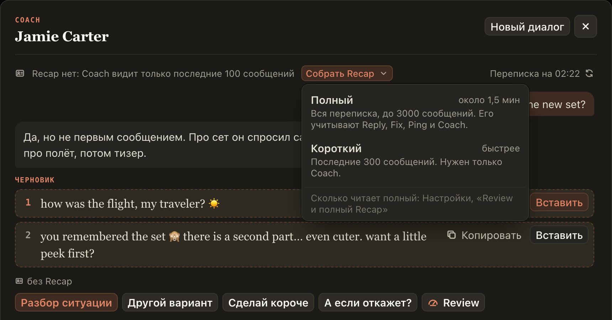

# Coach спрашивает, какой Recap собрать: полный или короткий

Кнопка «Собрать Recap» в Coach раньше сразу собирала полный Recap и не говорила об этом, а строка
«Собираю Recap» не называла, какой. Теперь у кнопки стрелка, и она открывает выбор:

- **Полный**: вся переписка, до 3000 сообщений, около полутора минут. Его учитывают Reply, Fix, Ping и Coach.
- **Короткий**: последние 300 сообщений, быстрее. Нужен только Coach.

Нажмите нужный, и он начнёт собираться. Пока он собирается, строка в Coach пишет, какой Recap и сколько
сообщений он читает. Если Recap уже есть, кнопка называется «Обновить Recap», а в выборе видно, когда
собран каждый.

## Как это устроено

Выбор собирает то же, что кнопки «Собрать полностью» и «Собрать коротко» в Recap над полем ввода, и
так же не открывает лист Recap за окном Coach. Сколько сообщений читает полный Recap, задаёт настройка
«Review и полный Recap» (на Fansly до 5000), и выбор показывает это число. Короткий читает последние 300,
но не больше полного. Клавишами: Enter на кнопке открывает выбор, стрелки двигают, Enter собирает.
