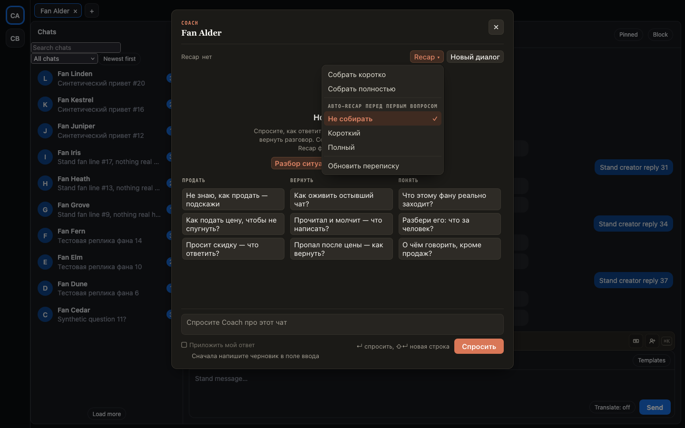

# Coach показывает, на какой Recap опирается, и авто-Recap включается прямо в нём

Раньше по Coach не было видно, есть ли у него Recap фана: без Recap шапка была пустой. Настройка
«Recap для Coach» пряталась в настройках расширения, и по подсказке было непонятно, что она делает.

Теперь:

- Слева в шапке Coach всегда написано, на что он опирается: «Recap · нет» или «Recap · полный · 3 д
  назад». Нажмите — откроется текст. Если короткий Recap новее полного, Coach читает оба, и в шапке видны оба.
- В меню «Recap ▾» — «Собрать коротко», «Собрать полностью» и «Авто-Recap перед первым вопросом»:
  «Не собирать», «Короткий» или «Полный». Это та же настройка, что в настройках расширения.
- Если авто-Recap включён, а свежего Recap нет, пустой диалог предупреждает, что первый ответ придёт позже.

## Как это устроено

К каждому вопросу Coach получает полный Recap фана для этой персоны и короткий, если тот новее полного.
Шапка показывает ровно их. Авто-Recap собирается один раз за диалог, перед первым вопросом, и только если
Recap моложе суток нет (для «Полного» — полного, собранного на текущей глубине переписки). Сборка Recap
читает всю переписку и расходует квоту, поэтому по умолчанию авто-Recap выключен. Настройка общая для всех чатов.
