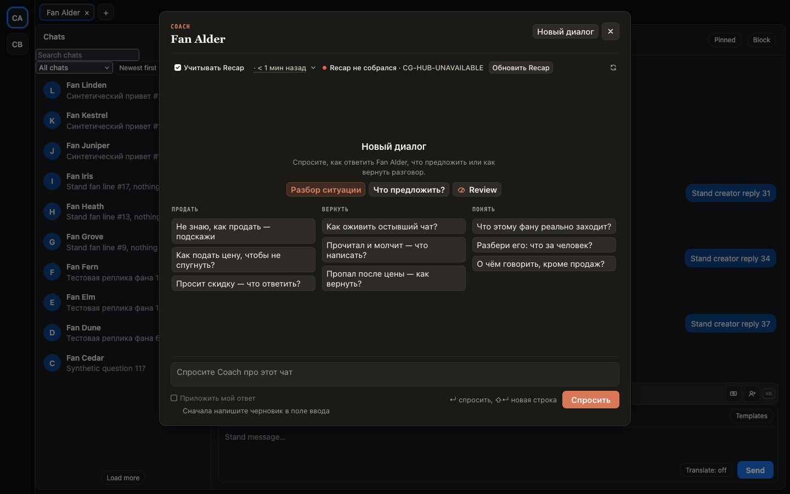

# Recap из Coach собирается в Coach, а не в полосе над полем за окном

Кнопка «Собрать Recap» или «Обновить Recap» в Coach раньше открывала ещё и лист Recap над полем
ввода: за окном Coach бежал текст, таймер и «Отменить», и было непонятно, что там происходит. Теперь
в Coach строка «Собираю Recap», а в полосе над полем только занята кнопка Recap. Когда Recap готов,
Coach пишет, сколько ему, и учитывает его в следующем ответе. Если сборка не удалась, Coach пишет
«Recap не собрался» рядом с кнопкой, и её можно нажать ещё раз. То же во вкладке Recap в карточке фана.

## Как это устроено

Coach и вкладка Recap в карточке фана просят ту же сборку, что и кнопка Recap в полосе, но с пометкой
«показываю сам». С ней док больше не открывает свой лист Recap. Если лист Recap в доке уже открыт, он,
как и раньше, показывает сборку. Ошибку сборки Coach берёт у самого Recap, поэтому видит и ту, что
началась с кнопки в полосе.
