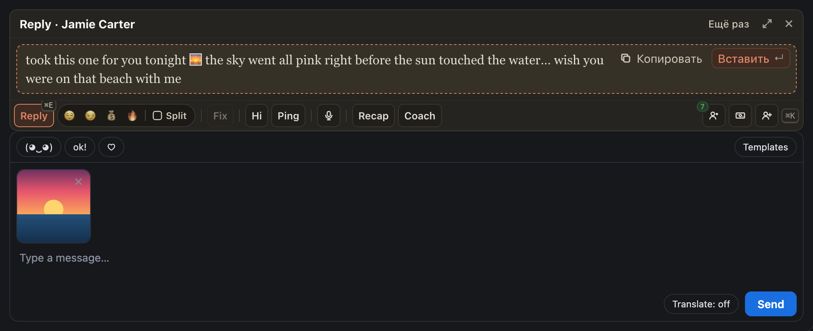

# Reply, Fix, Hi, Ping и Coach видят медиа, которое вы прикрепили к сообщению

Раньше ИИ писал текст вслепую: вы прикрепляли фото или видео, а Reply предлагал что-то своё, не про него. Теперь всё,
что лежит в поле ввода (фото, видео, GIF, аудио), уходит в ИИ вместе с запросом. Он смотрит на сами картинки (у видео
на обложку) и пишет текст под это медиа. Если сообщение платное, он подаёт его так, чтобы фан захотел открыть.

Как пользоваться: сначала прикрепите медиа, потом нажмите Reply, Fix, Hi, Ping или спросите Coach. Без медиа всё как
раньше.

## Как это устроено

По нажатию расширение читает поле ввода открытого чата: вид каждого медиа, длину видео и аудио, цену сообщения (на
OnlyFans; Fansly цену в поле ввода не показывает) и до 4 картинок такими, какими их показывает поле ввода: фото
целиком, у видео обложку. Картинки уходят ИИ только для этого одного ответа и нигде не хранятся, лишних запросов к сайту
нет. Видео целиком ИИ не смотрит, аудио не слышит: про них он знает только вид и длину. Review и Recap медиа черновика
не берут, они не пишут это сообщение. Владелец может выключить это в настройках хаба.
