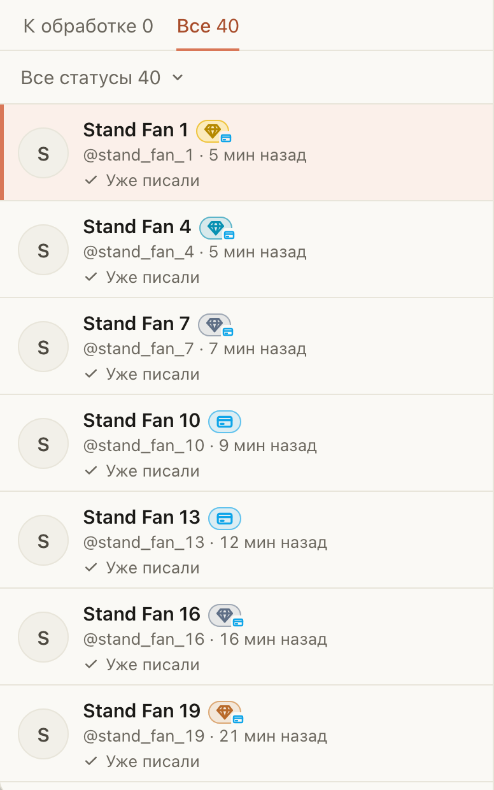

# Алмазики FBuddy и голубая карта теперь в «Новых», Spenders и «Рассылке»

Для чаттеров Fansly. Значки, которые появились в «Онлайн», теперь стоят рядом с именем фана везде, где вы выбираете,
кому писать:

- «Новые фоловеры»: новый фоловер с Gold или Platinum тратит у других моделей, его стоит поприветствовать первым;
- Spenders: в строках и в карточке фана видно, кто из наших платящих тратит и у других, а голубая карта говорит,
  что он платит сейчас;
- «Рассылка»: те же значки у каждого фана в списке.

Цвет алмазика: Bronze (до $100), Silver (до $1000), Gold (до $3000), Platinum (больше). Голубая карта: фан недавно
платил на Fansly. Наведите на значок, подсказка скажет уровень словами.

## Как это устроено

Значки берутся так же, как в «Онлайн»: голубая карта у Fansly в сессии модели, уровень у FBuddy под вашим входом в
FBuddy в этом Firefox. Окно спрашивает только фанов, которых показывает, сначала верхних, не больше 300 за раз и
каждого не чаще раза в 5 минут; ответ хранится 10 минут. Списки появляются сразу, значки догружаются за секунду.
На OnlyFans значков нет: это значки Fansly и FBuddy.
