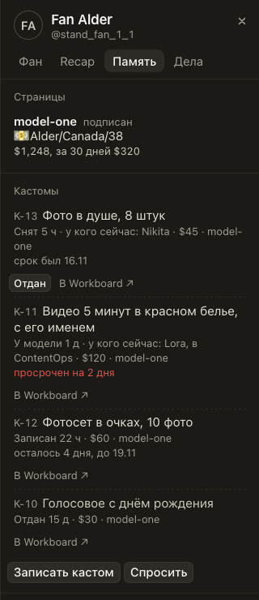

# Кастомы в «Памяти» фана: форма и вопрос из Workboard прямо над чатом

В «Памяти» (`]` → «Память») кастомы теперь те же, что в Workboard, и названы его словами: шаг («Записан», «У модели»,
«Снят», «Отдан»), у кого он сейчас и срок. Просроченный срок выделен цветом.

- «Записать кастом» открывает форму Workboard поверх чата: страница и фан уже вписаны, пароль не нужен. Записанный
  кастом сразу появляется в «Памяти».
- «Спросить» открывает окно вопроса Workboard (скидка больше 50%, бесплатно платное, цена кастома, условия для кита)
  для этого фана. Ответ придёт туда же, где его показывает Workboard, и посчитается на значке расширения.
- «Отдан» стоит у кастома, который вы можете отметить отданным прямо сейчас.
- «В Workboard ↗» открывает карточку кастома в Workboard в новой вкладке, без входа.

В окне расширения рядом с «Workboard» появились «Мои смены» и «Мои деньги»: обе открывают свои экраны Workboard без
пароля.

## Как это устроено

Форма и окно вопроса принадлежат Workboard: расширение показывает их в своей рамке поверх сайта и отдаёт им только
два запроса (записать кастом, задать вопрос) от имени устройства. Прежняя форма расширения и подсказки «Это оплата?»
и «Отдали: это он?» убраны: кастом ведётся в одном месте, в Workboard. «Отдан» делает тот же шаг, что кнопка на
карточке Workboard, и только когда Workboard его разрешает. «Мои деньги» могут показать, что раздел ещё закрыт:
это решает Workboard.
