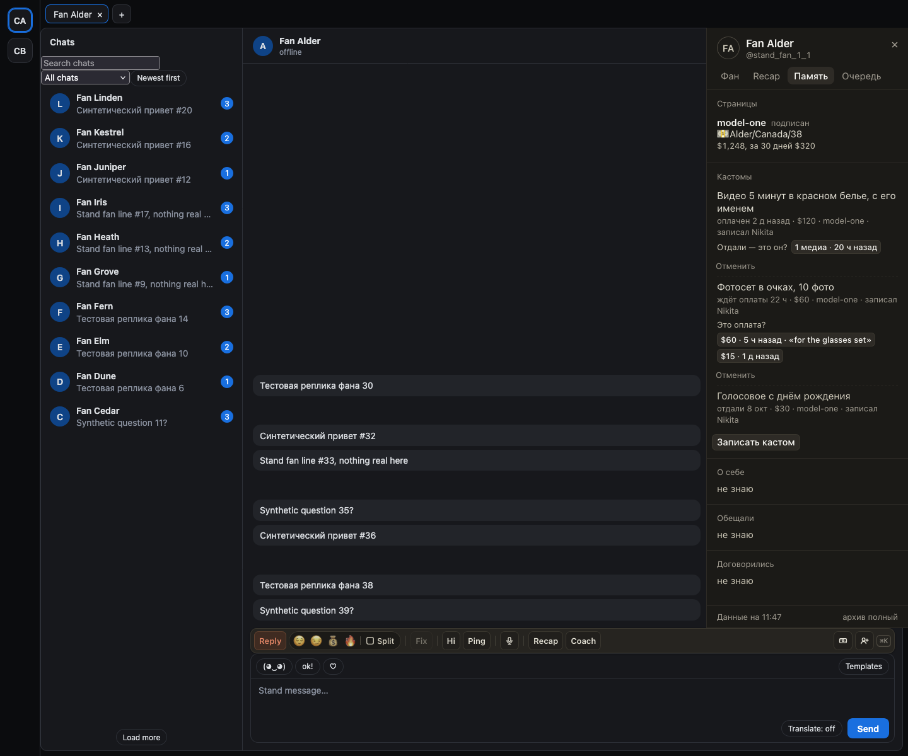
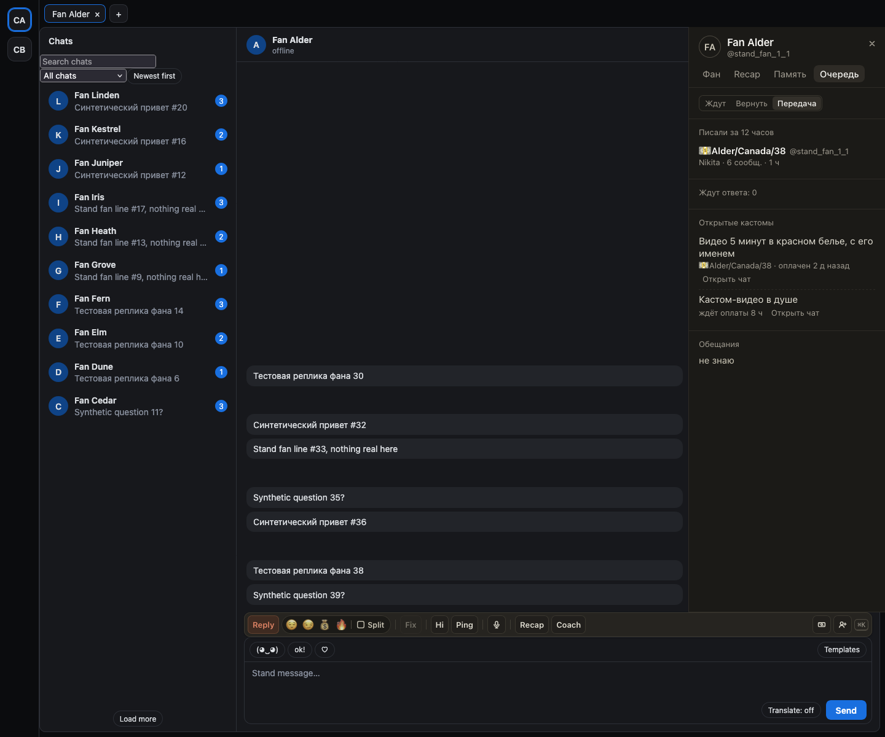

# Кастомы в «Памяти» фана и в «Передаче» смены

В «Памяти» (`]` → «Память») появился блок «Кастомы». Сверху открытые: что заказано, цена, «ждёт оплаты 22 ч» или
«оплачен 2 д назад», кто записал. Ниже отданные и отменённые за 30 дней.

Хаб сам ничего не отмечает, он только подсказывает, а вы подтверждаете одним касанием. «Это оплата?» показывает чаевые фана,
которые ещё не взял другой кастом, с суммой, временем и подписью. «Отдали: это он?» показывает медиа, отправленные фану после
оплаты. «Отменить» закрывает кастом. Отданный или отменённый кастом больше не меняется.

«Записать кастом»: что заказано, цена и, если уже заплатил, одна из подсказанных оплат.

В «Очереди» → «Передача» есть список открытых кастомов страницы, чтобы следующая смена их видела.

## Как это устроено

Кастомы хранятся в хабе. Отметить оплату или выдачу можно только по подсказке хаба; каждое касание отправляет один запрос, сам
он не повторяется. Менять кастомы можно на тех страницах, где вы работаете. Как модель снимает кастом, по-прежнему
решается в Telegram.
