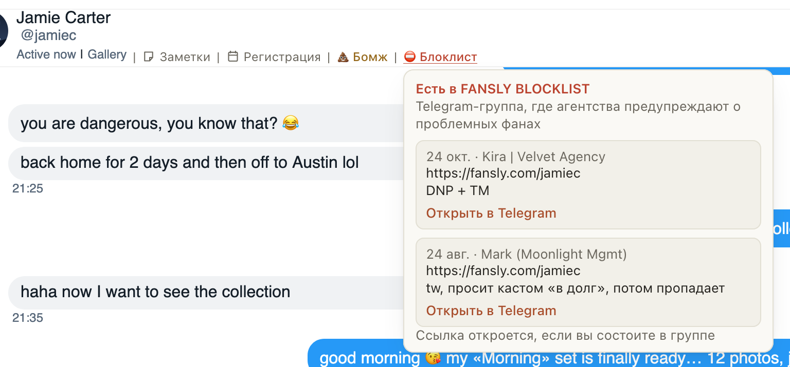

# Шапка чата Fansly предупреждает о фанах из «💩 Бомж» и блоклиста

Для тех, кто ведёт чаты на Fansly. Раньше, чтобы узнать, что с фаном уже были проблемы, приходилось помнить списки
каждой модели или искать его ник в Telegram. Теперь это видно сразу в шапке открытого чата, после «Заметки» и
«Регистрация»:

- «💩 Бомж»: фан в таком списке у этой модели или у других моделей агентства. Наведите на метку, и она скажет, у кого
  именно.
- «⛔ Блоклист»: о фане писали в Telegram-группе FANSLY BLOCKLIST, где агентства предупреждают о проблемных фанах.
  Нажмите на метку: откроются посты с датой и автором, а «Открыть в Telegram» ведёт к самому посту (если вы состоите в
  группе).

Это только предупреждение: писать фану и продавать ему ничто не мешает. У фана без таких отметок шапка не меняется.

## Как это устроено

Когда вы открываете чат, расширение один раз спрашивает хаб об этом фане: в каких списках Fansly с меткой вроде
«💩 Бомж» он есть на страницах агентства и что писали о его нике в FANSLY BLOCKLIST (до пяти последних постов). Ответ
хранится десять минут, так что чат, открытый снова, не спрашивает заново. Списки и группу читает хаб, расширение
ничего не отправляет ни на Fansly, ни в Telegram. Пока ответ не пришёл или если хаб недоступен, меток просто нет.
Ссылка на пост открывается только у участников группы: это закрытая группа Telegram.
