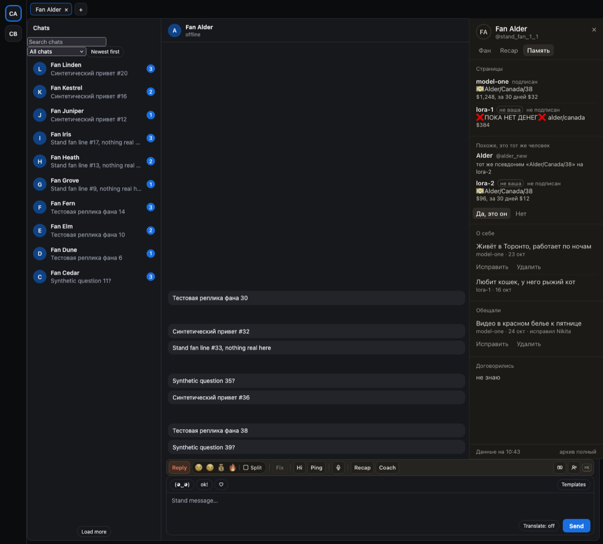

# «Память» в панели фана: его страницы, отметки команды и что он рассказал

В панели фана (`]`) появилась вкладка «Память». Сверху — все страницы, где есть этот фан, по сумме покупок:
псевдоним, который ему дала команда, с отметками 💵 и ❌, сколько он потратил всего и за 30 дней, подписан ли
он. Чужие страницы помечены «не ваша»: видно отметку и деньги, но не переписку. Теперь на ari-1 видно, что на
lora-1 этот фан помечен «❌ПОКА НЕТ ДЕНЕГ❌».

Если похоже, что новый аккаунт — тот же человек (тот же псевдоним «ник/страна/возраст» или тот же ник), появится
«Похоже, это тот же человек» с причиной. «Да, это он» связывает аккаунты, «Нет» больше не спросит.

Ниже — факты из переписки: «О себе», «Обещали», «Договорились», у каждого страница и дата. Ошибку можно
исправить или удалить. Где фан ничего не рассказал, написано «не знаю».

## Как это устроено

Вкладка читает карточку фана из хаба, только когда она открыта. Деньги — валовые суммы по всем связанным
аккаунтам. Связь аккаунтов решает чаттер: хаб только подсказывает и никого не связывает сам. Факты записывает AI
после каждого разговора, у каждого есть ссылка на сообщение. Пока владелец не включил запись фактов, разделы
фактов показывают «не знаю». Исправленный факт AI больше не трогает. «Открыть чат» у факта с другой страницы
открывает её чат, если её аккаунт есть в этой вкладке; к самому сообщению пока не прокручивает.
