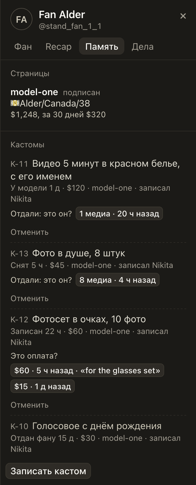

# Кастомы в «Памяти» показывают, на каком шаге заказ, и его код

Раньше заказ, который уже у модели, снят или на правке, мог показываться как «ждёт оплаты 3 д», если его оплату
записали в карточке, а не привязали к продаже. По такой строке легко попросить фана заплатить ещё раз.

Теперь у каждого кастома написан его шаг и сколько он на нём: «Записан 22 ч», «У модели 1 д», «Снят 5 ч», «Правка»,
«Отдан фану» и другие, теми же словами, что на доске «Кастомы». Перед описанием стоит код заказа, например K-11: по
нему заказ найдут на доске и в группе модели. То же в «Дела», вкладка «Передача», в открытых кастомах страницы.

## Как это устроено

Шаг, с какого времени заказ на нём, и код Hub присылает вместе с кастомами фана и кастомами страницы для «Передачи».
Слова шага берутся из той же таблицы, что у доски «Кастомы» в Workboard; расширение показывает их как есть. Если Hub
шага не присылает (старая версия Hub), кастомы выглядят как раньше.

Прежние версии расширения шага не знают. Для них Hub больше не называет «ждёт оплаты» заказ, который ушёл дальше
записи: такой заказ для них оплачен, кнопки «Отдали: это он?» и «Отменить» остаются, а если день оплаты неизвестен,
вместо него написано «состояние неизвестно».
