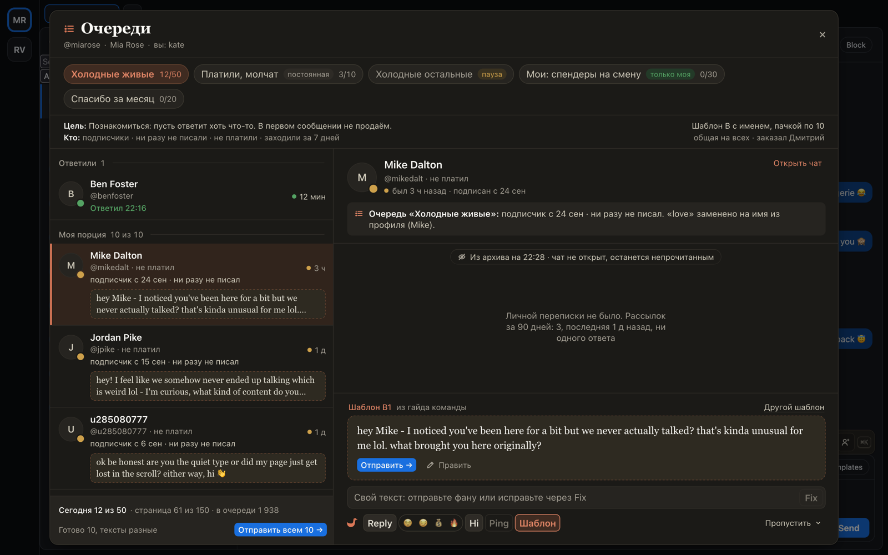

# «Очереди»: фаны, которых завели через Генгара, по порции в день

Когда нужно пройти много фанов (всех фолловеров, кто ни разу не писал, или тех, кто платил и замолчал), попросите
Генгара в Telegram, и он заведёт очередь. Она раздаёт фанов порциями по 10, у каждого чаттера свои, без повторов.

Кнопка «Очереди» на панели показывает, у скольких очередей есть работа на сегодня, а «1 ↩» значит, что фан ответил на
ваше сообщение из очереди: он первым в окне, с советом Reply. Справа карточка: почему фан в очереди, переписка и
текст. Шаблон или сообщение очереди уже стоит с именем фана, Ping и Reply пишутся по кнопке. «Отправить всем»
в очередях с шаблонами отправляет порцию по одному в секунду. «Пропустить ▾» спросит почему. Норма на день не
запрет: «Ещё 10» берёт следующую порцию. Вкладка «Очередь» в панели фана теперь называется «Дела».

## Как это устроено

Очереди хранит хаб: Генгар заводит их по правилу (кто платил, кто молчит, кто заходил) или по списку, общими на всех
или по людям. Окно берёт порцию до 10 фанов; хаб перепроверяет каждого (не написал ли он сам, не говорит ли с ним
другой чаттер) и держит порцию за вами 30 минут, пока окно открыто. Сообщение уходит только по вашему клику, тем же
путём, что в «Онлайн»: на OnlyFans через ChatSpace, на Fansly через расширение. Что ушло, что пропущено и почему,
хаб записывает один раз; неизвестный исход отправки не повторяется. Закрытое окно отдаёт нетронутых фанов обратно
в очередь, очередь на паузе держит своих. Через ⌘K окно открывается сразу на нужной очереди: там группа
«Очереди страницы».
