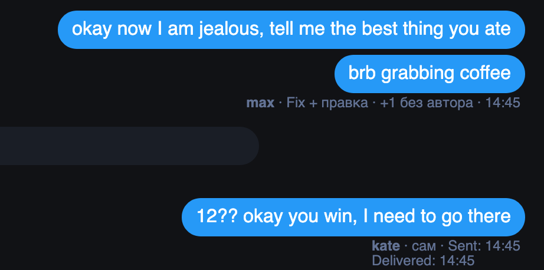

# На Fansly подпись «кто написал» больше не ставит чужое имя на одинаковые сообщения

Если один и тот же текст в чате отправляли двое, а вы прокрутили историю далеко вверх, под старым сообщением могло стоять имя того, кто отправил новое. Теперь такое сообщение остаётся без подписи: имя стоит только там, где известно точно.

Ещё поправили:

- клик по времени (Sent, Delivered, Read) больше не уносит подпись на отдельную строку;
- перевод FBuddy внутри сообщения не убирает подпись;
- «+1 без автора» считает только сообщения, для которых точно нет записи, а не те, что не удалось сопоставить;
- подписи не мигают, появляются и в первом чате после запуска браузера, а после выхода из аккаунта исчезают сразу.

## Как это устроено

Расширение сопоставляет сообщения на странице с тем, что видит его скрипт, по порядку и тексту. Раньше из нескольких подходящих мест оно брало первое; теперь подпись ставится, только если место одно. Сообщения без текста сопоставляются по порядку, когда рядом нет сомнений и они отправлены не в одну секунду.

Лента теперь слушается уже: только появление сообщений и строк времени, а не всё дерево. Вставки FBuddy не будят расширение, а изменение ленты не стоит запроса к скрипту страницы. К хабу расширение обращается при открытии чата и ещё дважды после нового сообщения, написанного человеком: рассылки и приветствия лишних запросов больше не вызывают. Подпись своей отправки приходит, даже если соединение с Fansly в этот момент переподключалось.
