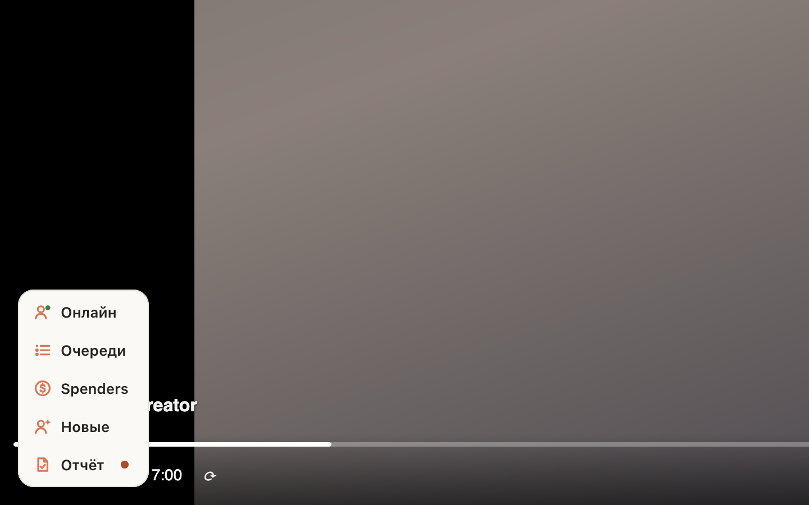
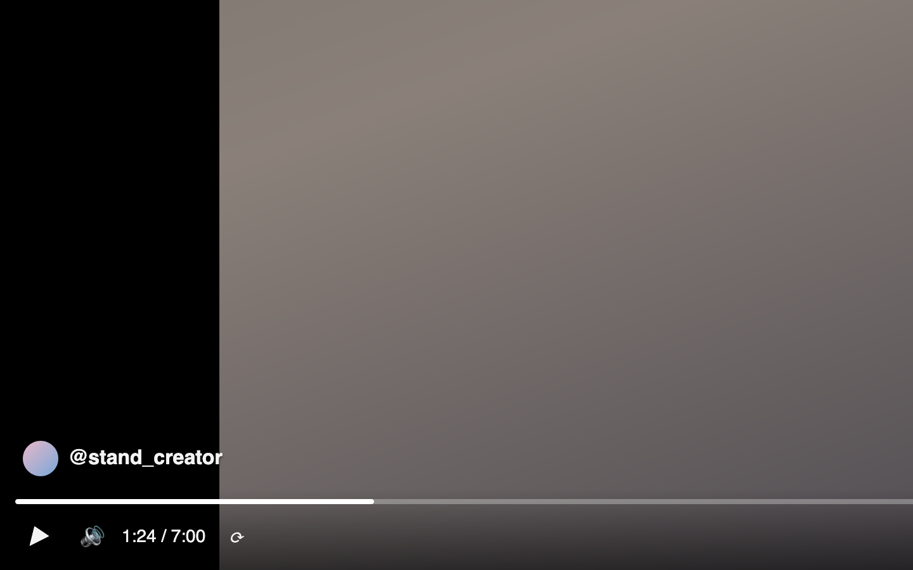

# Карточка в углу Fansly больше не закрывает кнопки видео

Для чаттеров Fansly. Когда вы открывали видео, карточка ChatGoose в левом нижнем углу («Онлайн», «Очереди»,
Spenders, «Новые», «Отчёт») стояла поверх него и закрывала кнопки плеера: запуск, звук и время. Так же поверх
окон Fansly стояли полоса «Отчёт смены» на Wallet history и кнопка «Загрузка» в волте.

Теперь, пока открыто окно Fansly (видео, загрузка, выбор из волта, чаевые) или его боковое меню, карточка и
полоса уходят под окно, как остальная страница, а свёрнутая «Загрузка» волта прячется. Закройте окно, и всё
вернётся на место. Spenders, «Новые» и ⌘K по-прежнему открываются поверх видео клавишами: ⌘⇧M, ⌘⇧U, ⌘K
(вне Mac Ctrl+Alt+M, Ctrl+Alt+U, Ctrl+K). Открытая карточка волта с идущей загрузкой остаётся поверх.

## Как это устроено

Пока у Fansly открыто любое окно или боковое меню, сайт закрепляет страницу (`position: fixed` у `body`).
Страница тогда рисуется одним слоем, и всё, что стояло вне её, оказывалось выше всего этого слоя вместе с
окном Fansly. Карточка, полоса «Отчёт смены» с подсветкой строки и панель над чужим полем ввода теперь
стоят внутри страницы на прежнем месте, и окно Fansly закрывает их так же, как свои элементы. Наши окна
(Spenders, «Новые», Coach, заметки) остаются выше окон Fansly. Свёрнутый вход волта прячется, пока страница
закреплена. Полноэкранное видео и раньше было выше всего.
