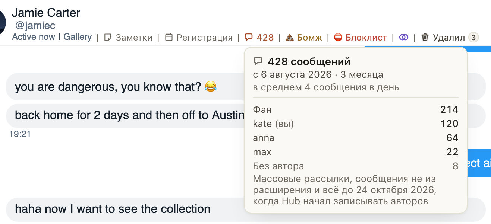

# Карточка длины переписки на Fansly показывает, кто из чаттеров сколько написал

Наведите на значок «💬 428» в шапке чата: под числом сообщений и средним теперь список, сколько написал фан и
сколько каждый чаттер, у кого больше, тот выше. Ваша строка помечена «(вы)». Так сразу видно, кто из команды вёл
этого фана и насколько плотно, без вопросов в общем чате.

Строка «Без автора» внизу: массовые рассылки, сообщения с телефона или из браузера без расширения и всё, что было
до 24 октября 2026, когда расширение начало записывать, кто отправил сообщение. Пока история чата не дочитана
до начала, в карточке только чаттеры, без фана.

## Как это устроено

Разбивка приходит в том же ответе хаба, что и число сообщений, при открытии чата: новых запросов нет, ни к хабу,
ни к Fansly. Сообщения чаттеров хаб считает по записям об отправке, которые расширение делает с 24 октября 2026
(те же, что у подписи «кто написал» под сообщениями модели); эти числа точные, даже когда история чата ещё не
дочитана. Числа фана и «Без автора» нужны всей истории: пока хаб не подтвердил её с первого сообщения, их нет.
Когда они есть, фан, чаттеры и «Без автора» в сумме дают число на значке. В карточке до 50 чаттеров; логин
показан так, как он записан в хабе.
