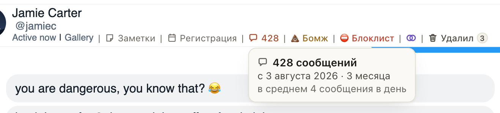

# Значок длины переписки на Fansly стал короче, подробности всплывают по наведению

В шапке чата значок теперь занимает меньше места: только число сообщений, например «💬 428», в том же
стиле, что «Регистрация» и «Удалил». Наведите на него: всплывёт карточка, сколько всего сообщений, с какого
дня идёт переписка и как давно, и сколько в среднем сообщений в день. Клик закрепляет карточку, Esc или клик
мимо её убирает.

Пока история чата не дочитана до начала, вместо числа значок показывает, как давно идёт переписка. Число
теперь появляется быстрее: история дочитывается в течение 15 минут после сообщения фана, а не на следующее утро.

## Как это устроено

Карточка открывается по наведению через 0,3 с, по фокусу с клавиатуры и по клику, как карточки меток фана и
«Удалил». Среднее считается от числа сообщений и дней с первого сообщения; если меньше одного в день, оно в
неделю, а у чатов младше недели его нет. Данные те же, что и раньше: ответ хаба, который расширение и так
получает при открытии чата, новых запросов нет. Хаб теперь каждые 15 минут подаёт заявку на чаты, где фан
написал, а начало истории ещё не подтверждено (раньше раз в сутки, утром). Темп запросов к Fansly прежний.
