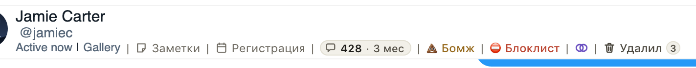

# В шапке чата на Fansly видно, сколько сообщений с фаном и как давно вы общаетесь

Открыли чат и не помните, новый это фан или вы переписываетесь с ним полгода? Теперь в шапке чата, сразу после
«Регистрации», стоит небольшой значок: сколько сообщений было в этом чате и как давно он начался, например
«428 · 3 мес». Наведите на значок: появится точная дата первого сообщения.

Число всегда точное. Если хаб ещё не дочитал историю чата до самого начала (так бывает с совсем новыми чатами),
значок показывает только, как давно начался чат, без числа.

## Как это устроено

Хаб хранит переписки страниц Fansly и для каждого чата знает, дошёл ли он до самого первого сообщения. Число берётся
из этой истории плюс сообщения последних минут, которые хаб уже услышал, но ещё не сверил: считаются сообщения обеих
сторон, удалённые тоже. Новых запросов нет: расширение и так один раз спрашивает хаб при открытии чата (для «Удалил»), и
длина чата приходит в том же ответе. К Fansly за этим не ходим. Если история неполная, дата берётся из номера самого
чата: Fansly зашивает в него время создания, а первое сообщение почти всегда приходит в тот же день.
