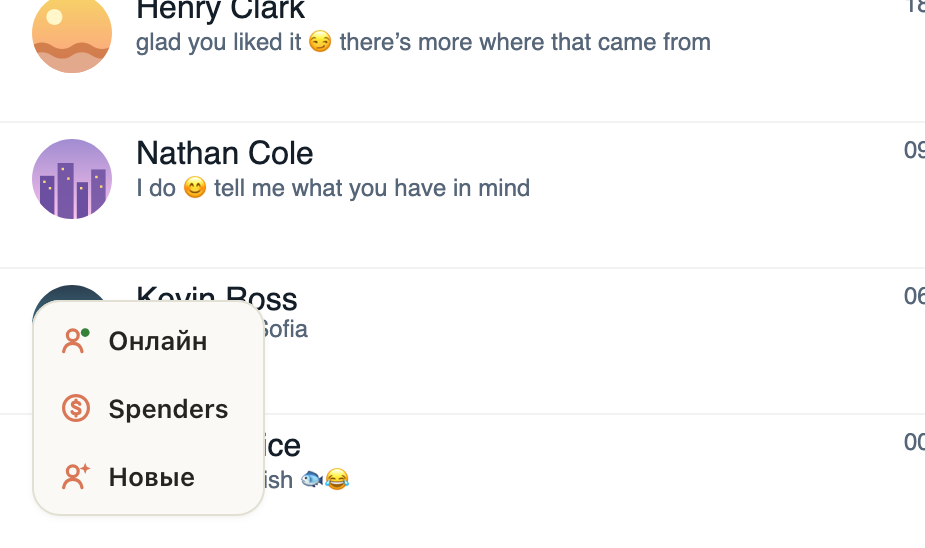

# В углу Fansly три кнопки столбиком: «Онлайн», Spenders и «Новые»

Кнопки в левом нижнем углу Fansly собраны в одну карточку и стоят столбиком. Их стало три: к Spenders и «Новые»
добавился «Онлайн». Раньше «Онлайн» открывался только из чата (кнопка на панели под полем ввода) или через ⌘K,
теперь он в один клик с любой страницы Fansly.

Значки нарисованы заново: у Spenders монета со знаком доллара, у «Новых» фан со звёздочкой, у «Онлайн» фан
с зелёной точкой. Те же значки теперь у этих кнопок на панели под полем ввода, на OnlyFans тоже.

## Как это устроено

Карточка рисуется сразу после загрузки страницы, до остального расширения: первый клик подгружает его и открывает
нужное окно. «Онлайн» открывает то же окно, что кнопка на панели под полем. Своей клавиши у «Онлайн» нет, у Spenders
и «Новых» остались ⌘⇧M и ⌘⇧U (Ctrl+Alt+M и Ctrl+Alt+U вне Mac). Свёрнутая «Рассылка» теперь стоит над карточкой.
Модалки Fansly, как и раньше, закрывают карточку.
