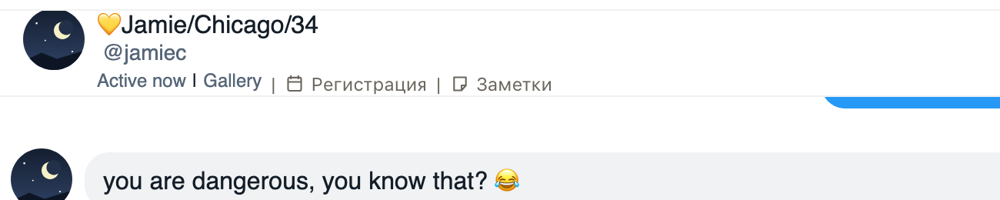

# Своё имя фана в шапке чата на Fansly тоже видно целиком

Если фану дали своё имя в «Notes / Custom Name» (например, «Michael/Sweden»), Fansly показывает в шапке чата
его, а не ник фана, и тоже режет до 10 знаков: «Michael/Sw...». Прошлое исправление расширяло только ник,
поэтому такие имена оставались обрезанными. Теперь своё имя в шапке видно целиком.

## Как это устроено

Fansly хранит своё имя фана как особую заметку на его аккаунте и показывает её в шапке первой, а без неё
отображаемое имя или ник. Расширение берёт эту заметку из тех же ответов Fansly, что уже читает для фана
открытого чата, и ставит имя целиком на место обрезанного, только если обрезанное совпадает с его началом.
Если имя поменяли в заметках расширения, шапка Fansly покажет новое после перезагрузки страницы. Список чатов
слева остаётся как есть.
