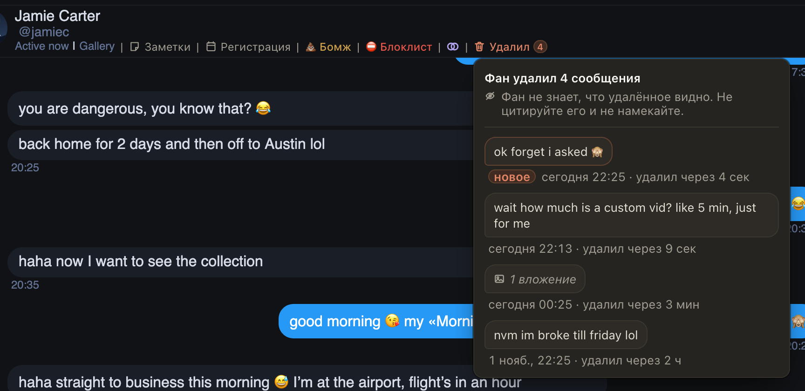

# На Fansly видно, какие сообщения фан удалил

Фаны иногда пишут и сразу стирают: спросили цену кастома, передумали, написали лишнее. Раньше такое сообщение
пропадало из чата, и вы могли его вообще не увидеть. Теперь в шапке чата, после меток фана, стоит «Удалил» и число:
сколько сообщений этот фан удалил. Наведите на метку или нажмите на неё: откроется список удалённых сообщений с текстом,
временем отправки и тем, через сколько фан их стёр.

Если фан удалил сообщение недавно, метка подсвечена, а у сообщения стоит «новое». Подсветка уходит, когда вы открыли
список. Фан не знает, что удалённое видно: не цитируйте его и не намекайте на него.

## Как это устроено

Хаб сам слушает чаты страниц Fansly и хранит текст сообщений, даже если фан их потом удалил. При открытии чата
расширение один раз спрашивает у хаба удалённые сообщения этого фана: последние 50 с текстом и сколько их всего. Если
фан удаляет сообщение, пока чат открыт, метка обновляется через пару секунд. Подсвечены удалённые за последний час,
которых вы ещё не открывали в этой вкладке. Видны удаления с 1 октября: раньше хаб их не записывал. Фото и видео из
удалённых сообщений не показываются, только сколько их было. Reply и Coach удалённые сообщения не видят. На OnlyFans
фаны почти ничего не удаляют, поэтому метка только на Fansly.
