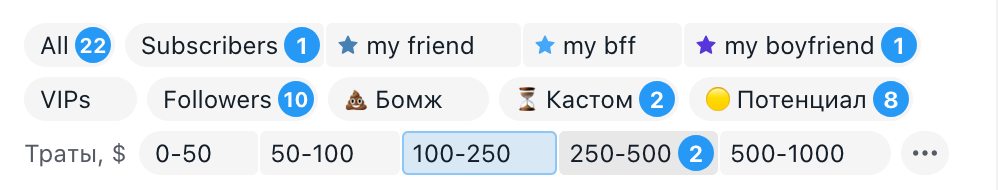

# Фильтры над чатами Fansly спокойно выглядят и в светлой теме

В светлой теме Fansly «Две полки» и «Четыре группы» при наведении закрашивали чип тёмно-синим, и надпись на нём
пропадала. Подсказка у «⋯» тоже была тёмной на тёмном. Теперь наведение только чуть затемняет чип, выбранный фильтр
подсвечен светло-голубым, как у самого Fansly, а подсказки и меню белые с тонкой рамкой. В тёмной теме всё как было.

## Как это устроено

Цвета полос больше не прописаны под тёмную тему: они берутся из цветов самой страницы Fansly, поэтому
сами подстраиваются под светлую и тёмную тему.
