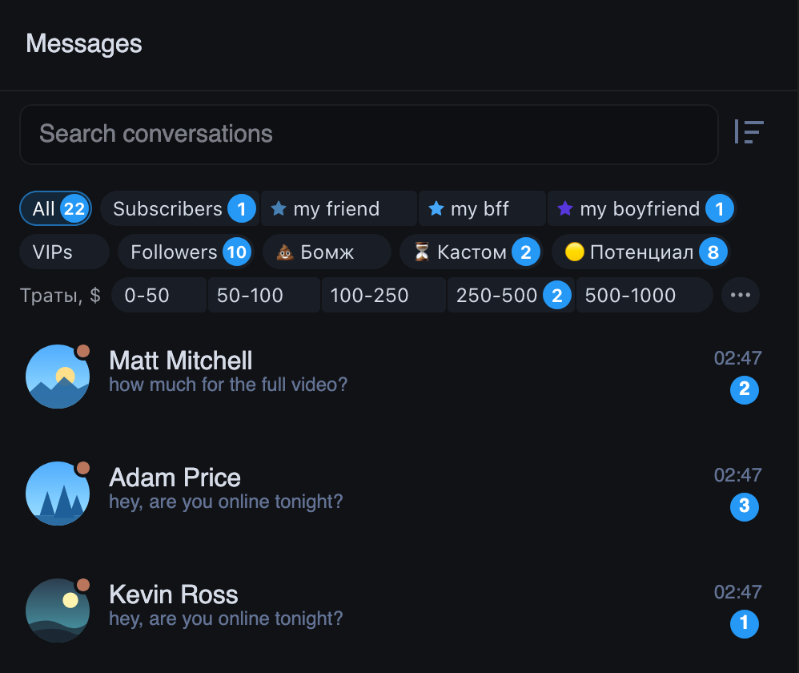
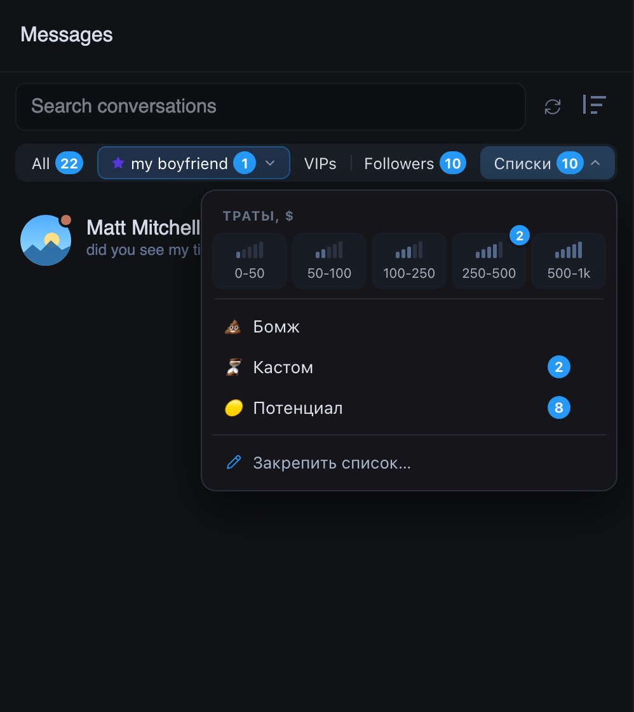
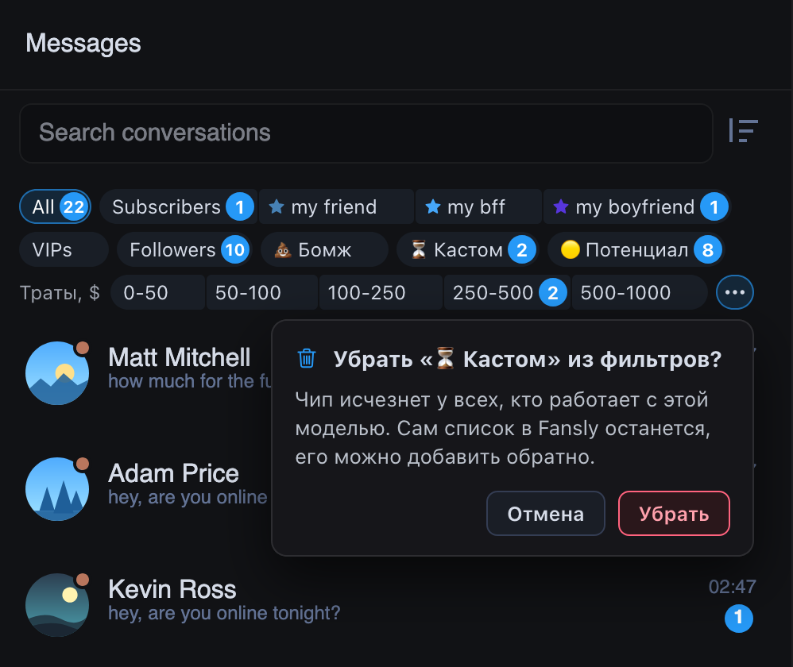

# Фильтры над чатами Fansly: два новых вида на выбор

Фильтры над списком чатов Fansly (All, Subscribers, тиры, VIPs, Followers, закреплённые списки) на рабочих моделях
занимали до шести строк. Теперь их можно показать компактнее. Вид выбирается в настройках ChatGoose: «Вид и звук»,
строка «Фильтры над чатами».

- **Две полки** (стоит сразу): All и Subscribers с тирами, ниже VIPs, Followers и списки, ниже ступени трат FBuddy.
  Не больше пяти строк, лишнее уходит под «ещё N». За «⋯»: добавить список, убрать список, обновить счётчики.
- **Четыре группы**: одна строка All, Subscribers, VIPs, Followers, Списки. Тиры и списки в меню, последний
  выбранный тир и список остаются на кнопке. Число у «Списки» без повторов: чат из двух списков считается один раз.
- **Как в Fansly**: прежние чипы Fansly.

Фильтры работают как у Fansly, меняется только вид. Список теперь убирается после вопроса: его чип пропадает у всех,
кто работает с моделью.

## Как это устроено

Чипы Fansly остаются на странице, только скрыты. ChatGoose читает их (какие есть, какой выбран, какие числа) и рисует
заново; нажатие на фильтр нажимает чип Fansly. Полные названия тиров и списков берутся из ответов самого Fansly,
расширение ничего у Fansly не запрашивает. Число «Списки» считается по тем же данным, что и счётчики Fansly; пока
оно не сходится с числами Fansly, вместо него стоит точка. Если Fansly поменяет свои чипы или колонка уже 300 px,
возвращаются чипы Fansly. Выбранные тир и список запоминаются в этом браузере, у каждого чаттера свои, отдельно по
каждой модели.
