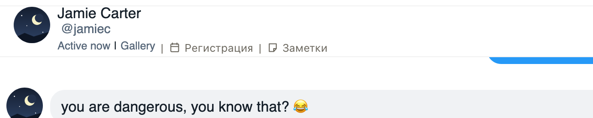

# Полный ник фана в шапке чата на Fansly

Fansly в шапке открытого чата обрезает имя фана до 10 знаков: «Chet/Austr...», «Jamie Cart...». Теперь там
полное имя, и чтобы понять, кто это, не нужно открывать профиль фана. Карточка фана и подписи расширения тоже
берут полное имя, а не обрезанное из шапки.

## Как это устроено

Fansly сам режет имя в шапке чата (10 знаков) и в списке чатов (12). Полное имя есть в ответах Fansly, которые
расширение уже читает, чтобы знать фана открытого чата. Расширение ставит его в шапку на место обрезанного,
только если обрезанное совпадает с началом полного имени. Если у фана нет отображаемого имени, Fansly
показывает ник, и расширение ставит полный ник. Список чатов слева остаётся как есть.
