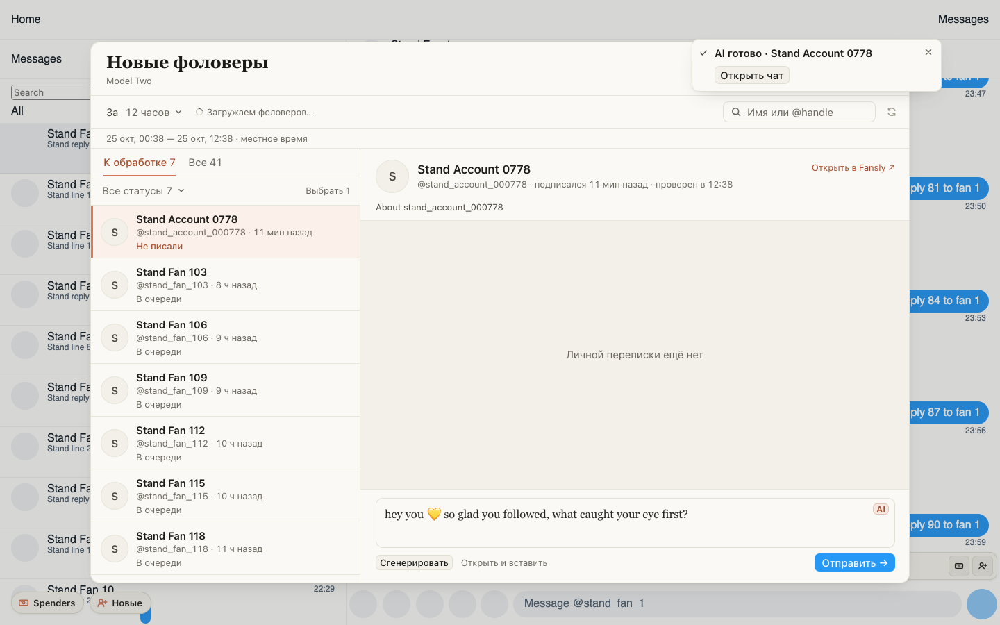

# «Ждёт приветствия» на Fansly: напоминание не теряется, Hi находит фана сам

Если Fansly в момент проверки просил подождать или ответил с ошибкой, напоминание «Ждёт приветствия» больше не
пропадает: расширение пробует снова каждую минуту. Кнопка Hi в уведомлении сама убирает поиск и фильтр в «Новых
фоловерах», поэтому карточка этого фана открывается всегда. Если фан там уже проверен (например, окно сегодня
уже открывали), приветствие сразу появляется в поле. Если окно открывается впервые и проверка ещё идёт, нажмите
«Сгенерировать» на карточке, когда фан проверится.

## Как это устроено

Проверка через 10 минут теперь только читает и ничего не создаёт на Fansly: список чатов модели (свежие сверху)
и историю тех чатов, что в нём нашлись. Если чата фана в списке нет за всё время после фолова, значит, никто не
писал. Всех свежих фоловеров одной модели проверяет одно чтение списка. Пока Fansly просит подождать или чтение не
удалось, проверка повторяется раз в минуту, но не дольше часа после фолова. Фан, который вернулся и с которым модель
переписывалась давно, может получить напоминание, хотя его уже приветствовали раньше. Hi ждёт проверки фана до
8 секунд: дольше клик не даёт права запустить генерацию.
