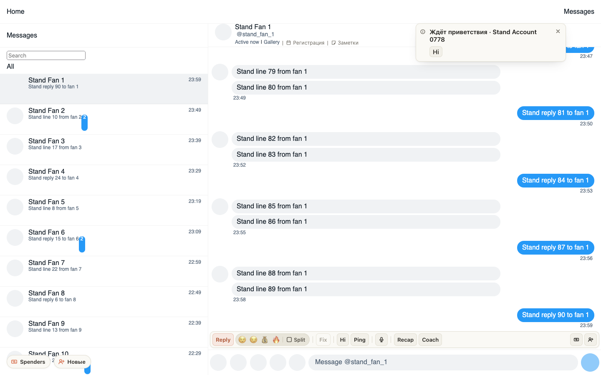
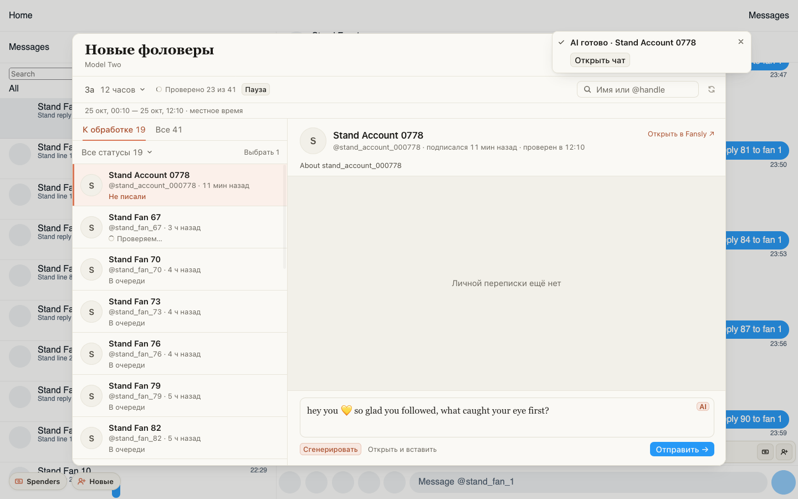

# Напоминание «Ждёт приветствия» теперь и на Fansly

Если новый фоловер за 10 минут так и не получил приветствие и сам не написал, справа вверху появится уведомление
«Ждёт приветствия · имя фана» с кнопкой Hi — как в ChatSpace. Hi открывает «Новые фоловеры» на карточке этого фана.
Если его чат уже проверен, приветствие сразу пишется в поле; если нет — фан проверяется первым, и Hi нажимается
на карточке («Сгенерировать»). Ничего не отправляется само.

Уведомление само не пропадает: закройте его ×, если фаном уже занимается кто-то другой. О каждом фолове оно
приходит один раз и только во вкладку модели, на которую подписались.

## Как это устроено

Расширение слышит новый фолов из живого соединения вкладки Fansly — то же событие, что звук подписки. Через
10 минут оно проверяет чат фана: несколько запросов от имени модели, автоприветствие модели приветствием не
считается. Уведомления нет, если в чате есть личное сообщение модели, фан написал сам или Fansly не даёт модели
ему написать. Фолов, пришедший, пока ни одна вкладка модели не открыта, расширение не увидит. Фоловеры старше
часа остаются только в «Новых фоловерах».
