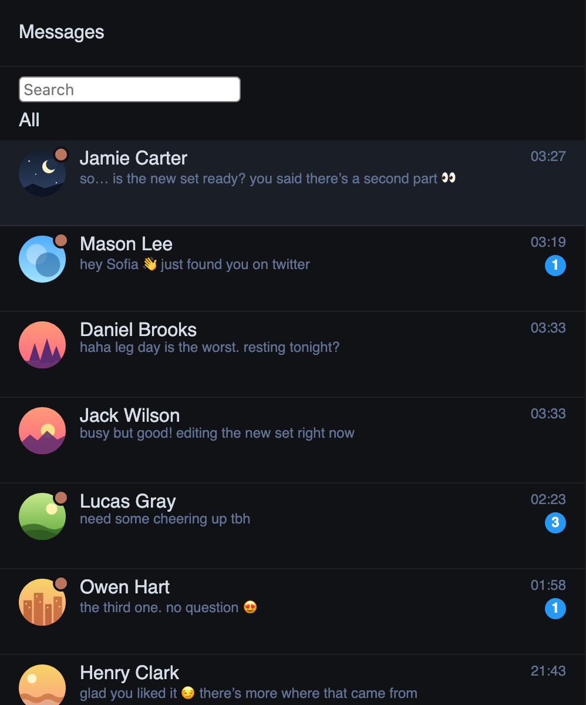

# В списке чатов Fansly видно, кто ждёт ответа

Fansly показывает в списке чатов текст последнего сообщения, но не говорит, чьё оно. Открыли чат, отвлеклись, и
кажется, что уже ответили, а фан ждёт.

Теперь на аватаре фана, который написал последним и ещё не получил ответа, стоит приглушённая оранжевая точка. Она
остаётся, даже если чат уже открыт и прочитан, и пропадает, как только модель ответила. Массовая рассылка ответом не
считается.

Если привычнее как в мессенджерах, в настройках («Вид и звук», «Кто ждёт ответа») можно выбрать «Мы:» перед текстом
там, где ответила модель, или выключить метку.

## Как это устроено

Лишних запросов к Fansly нет: расширение читает то, что страница уже загрузила (список чатов с последним сообщением
каждого чата и новые сообщения из её соединения с сервером). Для каждого чата запоминается последнее сообщение фана
и последнее личное сообщение модели; рассылки и автоприветствия ответом не считаются. Точка рисуется прямо в строке
Fansly и обновляется, как только приходит сообщение. Метки появляются, когда на Fansly открыт чат с панелью
ChatGoose. Ограничение: если фан написал до того, как вкладку открыли, а после него ушла рассылка, расширение знает о
нём, только пока его сообщения не прочитаны.
