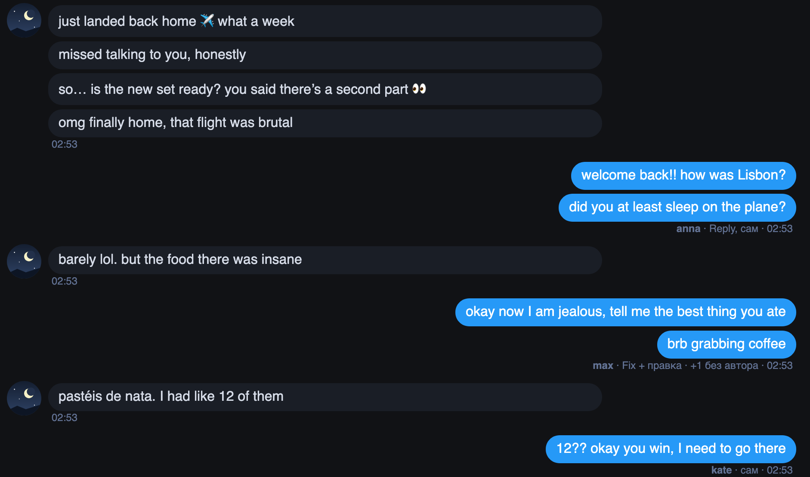

# На Fansly под сообщениями модели видно, кто их написал

Под сообщениями модели, перед временем, теперь стоит логин того, кто их отправил, и как написан текст: Reply, Fix,
Hi, Ping, Coach или «сам», если набран руками. Если текст после Reply или Fix поправили перед отправкой, рядом стоит
«+ правка». Так видно, кто из команды отвечал фану до вас и чем, без вопросов в общем чате.

Подпись есть у сообщений, отправленных из браузера с расширением начиная с 24 октября. Сообщения с телефона, из
браузера без расширения и массовые рассылки остаются без подписи; если такое сообщение стоит в одной группе
с подписанными, рядом написано «+1 без автора».

## Как это устроено

Хаб уже записывает, кто отправил каждое сообщение. При открытии чата расширение один раз спрашивает у хаба авторов
последних 200 сообщений этого фана и ставит подпись в строку со временем, которую Fansly рисует под группой
сообщений: новых строк в чате нет, лишних запросов к Fansly тоже. В разметке Fansly у сообщений нет id, поэтому
расширение сопоставляет их по порядку и тексту с тем, что видит его скрипт на странице. Если сопоставить не
получилось, подписи нет: чужое имя расширение не ставит. Новое сообщение, своё или коллеги, подписывается через
несколько секунд, когда его отправка дошла до хаба. В ChatSpace такая подпись уже есть у самого OnlyMonster:
«Sent by».
