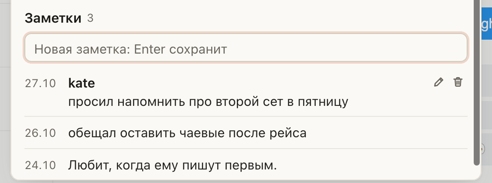

# Новая заметка на Fansly подписана именем того, кто её написал

Раньше заметки в «Заметках» шли без подписи, и было непонятно, кто из смены что записал про фана. Теперь
новая заметка из поля «Новая заметка» сохраняется с вашим логином в заголовке. Его видно у нас в панели, у коллег
и в окне заметок самого Fansly. Делать ничего не нужно: напишите строку и нажмите Enter, как раньше.

## Как это устроено

Имя пишется прямо в заметку Fansly: заголовком становится ваш логин в ChatGoose (тот же, что в пометке
«в разговоре»). Отдельно имя нигде не хранится, поэтому подпись видна везде, где видна заметка. Старые заметки
без подписи остаются как были, правка заметки её заголовок не меняет. Анкету по-прежнему пишут все вместе, она
идёт без подписи.
