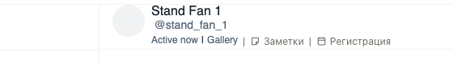

# «Заметки» в шапке чата стоят перед «Регистрацией»

В шапке открытого чата Fansly кнопка «Заметки» теперь идёт сразу после «Gallery», а «Регистрация» правее
неё. Заметками пользуются чаще, поэтому они ближе к имени фана.

## Как это устроено

Обе кнопки встают в один ряд шапки по своему номеру места: у «Заметок» он теперь меньше, чем у
«Регистрации», и ряд собирается в новом порядке.
