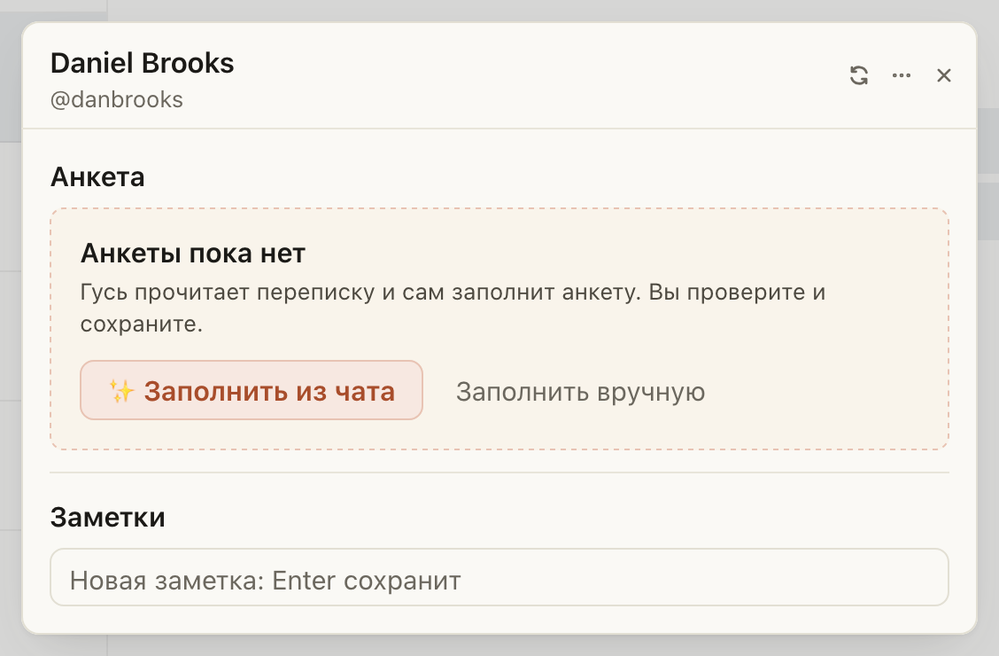
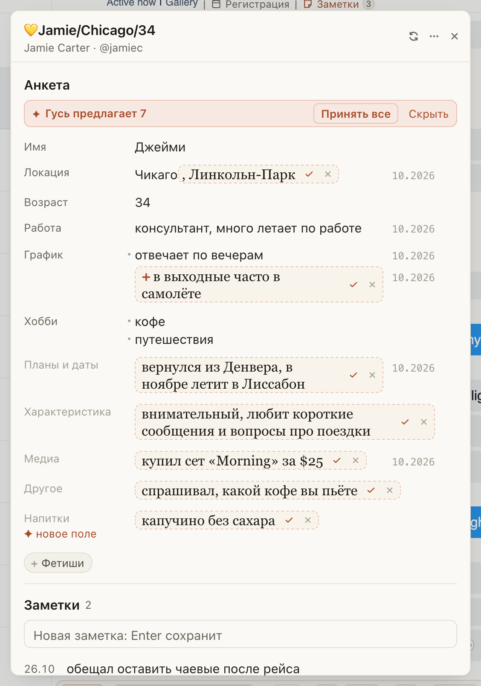
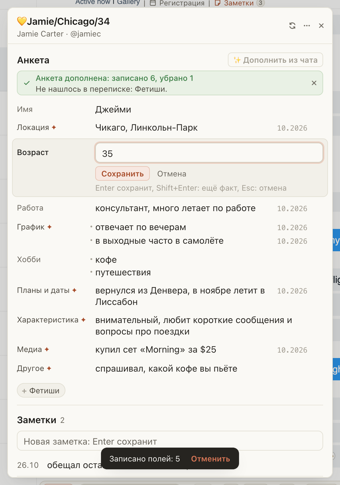

# Заметки на Fansly: Гусь подсказывает прямо в анкете, а записываете вы

Раньше анкету заводили через «+ Анкета»: открывалась пустая форма из одиннадцати окошек, и уже из неё звали
«Дополнить из чата». Теперь всё на одном экране, и заполнить анкету из переписки можно первым же нажатием:

- у фана без анкеты сверху стоит «✨ Заполнить из чата», у заполненной в её шапке «✨ Дополнить из чата»;
- найденное встаёт подсказками прямо в нужные строки анкеты. Наведите на подсказку: видно, что написал фан;
- ✓ записывает подсказку, × убирает, «Принять все» записывает всё сразу. Без вашего ✓ в анкету ничего не попадёт, а
  «Отменить» внизу несколько секунд возвращает как было;
- нажмите на строку анкеты, поправьте и нажмите Enter: поле сразу сохранится в Fansly;
- новая заметка: строка в поле «Новая заметка» и Enter. Заметки идут от новых к старым, дата слева.

## Как это устроено

Анкета остаётся обычной заметкой Fansly со строками «Поле: значение», её видно и в окне заметок Fansly. «✨ Заполнить
из чата» отправляет в хаб, как и раньше, только поля анкеты и их значения. Подсказки видите только вы, в Fansly
попадает только принятое: каждый ✓ это одна правка анкеты, «Принять все» одна правка со всем. Если поле успели
изменить, пока подсказка ждала, Гусь не перезапишет его сам, а спросит «Заменить?». Поле, которое Гусь завёл сам
(например, «Питомцы»), встаёт отдельной строкой с пометкой «новое поле». Неразобранные подсказки ждут до следующего
открытия заметок. Правка поля меняет только его строку и пишется в ту версию анкеты, что сейчас в Fansly: правка
коллеги в другом поле не пропадёт. «Править текстом» открывает анкету одним текстом, как в окне Fansly. Где показывать
заметки (окно по центру, справа по кнопке, всегда справа), выбирается в меню «⋯» в шапке панели; ⌘⇧K как раньше.
