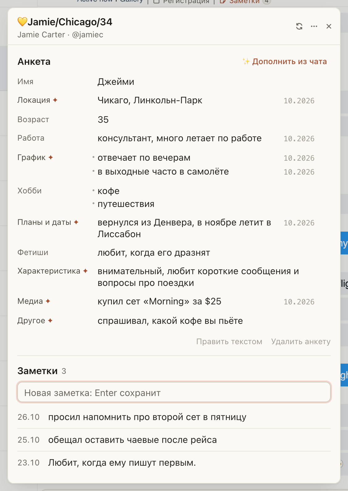

# Заметки на Fansly: поле правится по клику, а Гусь показывает, что нашёл

Раньше одна правка превращала всю анкету в форму из одиннадцати окошек, а «✨ Дополнить из чата» часть фактов вписывал
сам, часть прятал под полями с «Принять» и ждал ещё «Сохранить». Теперь всё на одном экране:

- нажмите на строку анкеты, поправьте и нажмите Enter: поле сразу сохранится в Fansly;
- пустые поля стоят кнопками «+ Фетиши», «+ Медиа»: нажали, вписали, Enter;
- «✨ Дополнить из чата» показывает списком, что Гусь нашёл, со словами фана. Снимите галочки с лишнего и нажмите
  «Записать в анкету». Записанное отмечено ✦;
- у фана без анкеты «✨ Заполнить из чата» сразу создаёт её;
- новая заметка: строка в поле «Новая заметка» и Enter. Заметки идут от новых к старым, дата слева.

## Как это устроено

Анкета остаётся обычной заметкой Fansly со строками «Поле: значение», её видно и в окне заметок Fansly. Правка поля
меняет только его строку и пишется в ту версию анкеты, что сейчас в Fansly: правка коллеги в другом поле не пропадёт.
«✨ Дополнить из чата» отправляет в хаб, как и раньше, только поля анкеты и их значения. Найденное не пишется никуда,
пока вы не нажмёте «Записать в анкету»; поле, которое успели изменить, пока вы выбирали, Гусь не перезапишет и назовёт
его. Поле, которое Гусь завёл сам (например, «Питомцы»), встаёт отдельной строкой: снимите галочку, если оно не нужно.
«Править текстом» открывает анкету одним текстом, как в окне Fansly. Где показывать заметки (окно по центру, справа
по кнопке, всегда справа), теперь выбирается в меню «⋯» в шапке панели; ⌘⇧K как раньше.
