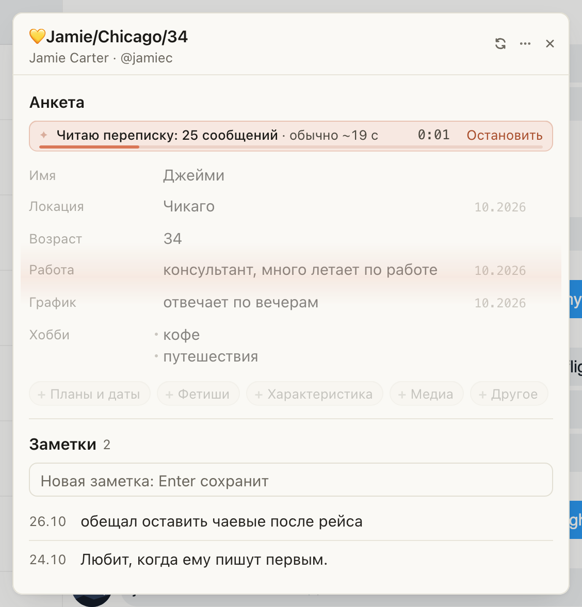

# Заметки на Fansly: видно, сколько сообщений читает Гусь и сколько обычно ждать

Пока Гусь заполняет анкету из переписки («✨ Заполнить из чата» или «✨ Дополнить из чата»), в строке раньше было
только «Читаю переписку…», и было непонятно, долго ли ждать. Теперь видно, сколько сообщений он читает и сколько это
обычно занимает, например «Читаю переписку: 25 сообщений · обычно ~19 с». Полоса под строкой заполняется за это
время, справа идёт таймер. Длинная переписка читается дольше: тысяча сообщений около 50 секунд, самые длинные до
полутора минут. «Остановить» прерывает в любой момент.

Подсказки тоже стали живее: встают в строки анкеты по очереди, записанная по ✓ загорается в своей строке с зелёной
галочкой, убранная по × тает на месте.

## Как это устроено

Хаб берёт до 3000 последних сообщений переписки и сразу сообщает, сколько взял: это число и стоит в строке. Обычное
время посчитано по прошлым заполнениям анкет на переписках такой же длины: от ~20 секунд на сотню сообщений до ~1,5
минуты на три тысячи. Полоса за это время доходит почти до конца и ждёт ответа. Если ответ задерживается, полоса стоит,
а таймер показывает, сколько прошло. Ответ приходит целиком, когда Гусь сам его перепроверит, поэтому подсказки
встают в строки все вместе. В анкету по-прежнему ничего не попадает без вашего ✓. С системной настройкой «уменьшить
движение» анимации выключены.
