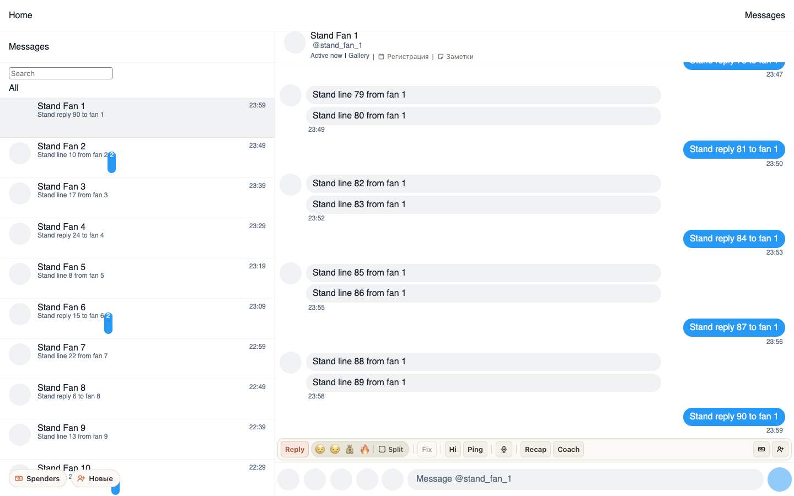
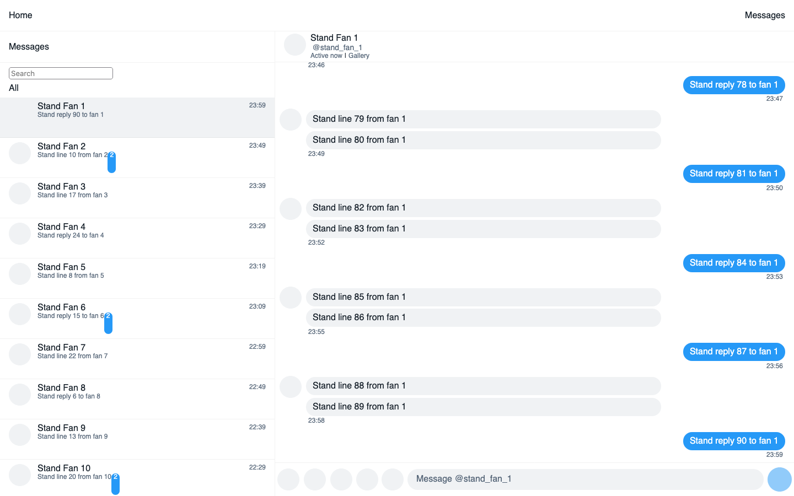

# Fansly выключен в расширении: док уходит со страницы, а не отвечает «функция выключена»

Если ChatGoose на Fansly выключали в окне расширения или Firefox снимал доступ к fansly.com, открытая
вкладка Fansly этого не замечала: док с кнопками оставался, а Reply, Fix и остальные отвечали «Функция
выключена для страницы», хотя у страницы всё включено. Теперь док, «Заметки», «Регистрация» и кнопки
Spenders и «Новые» сразу уходят со страницы. Чтобы вернуть их, нажмите «Включить Fansly» в окне
ChatGoose: открытые вкладки Fansly перезагрузятся сами.

## Как это устроено

Когда Fansly выключается (выключатель в окне расширения или снятое право Firefox на сайт), фон
отпускает открытые вкладки Fansly. Вкладка подключается заново, слышит новый код `CG-SITE-OFF` и убирает
с Fansly всё наше. Если клик успел до этого, карточка говорит «Fansly выключен в расширении», а не
«Функция выключена для страницы». Решение ждёт конца перенастройки доступа, которая идёт в этот момент,
поэтому вкладку не уберёт короткий промежуток после обновления расширения. Если же фоновая часть Fansly
не запустилась, Reply отвечает «Расширение не отвечает» с кнопкой «Повторить», как и остальные запросы
к Fansly в этот момент. Выключатели страницы на хабе по-прежнему отвечают «Функция выключена».
