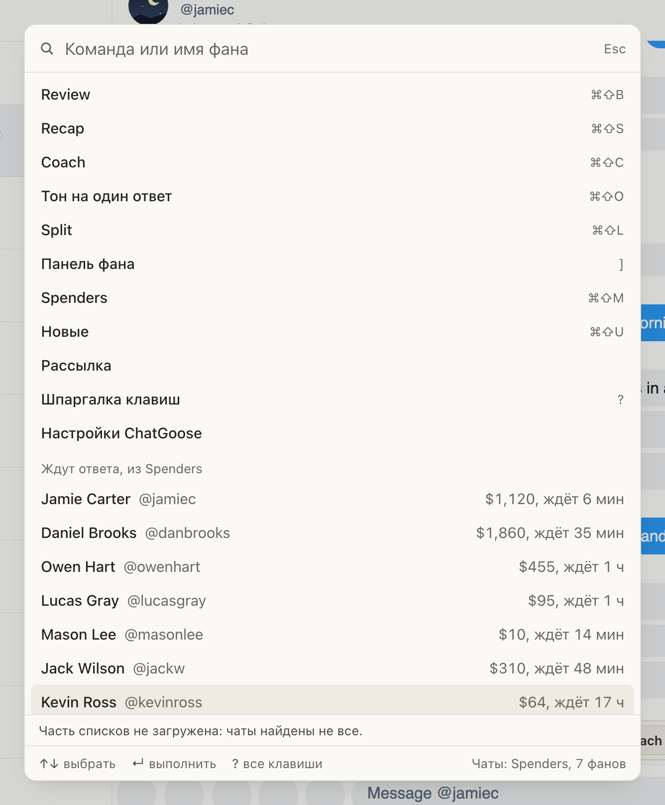
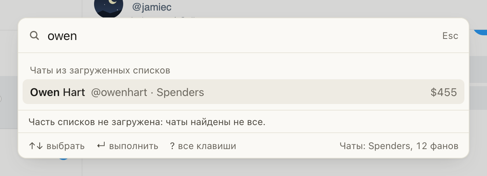

# Палитра команд ⌘K теперь и на Fansly

Для чаттеров Fansly. ⌘K (на Windows Ctrl+K) открывает палитру команд, как в ChatSpace: действия в открытом чате
(Reply, Fix, Hi, Ping, Recap, Coach), окна (Spenders, «Новые», «Рассылка», шпаргалка клавиш), фаны, которые ждут
ответа, из Spenders, и поиск фана по имени или нику по всей доске Spenders. Выберите строку стрелками и нажмите
Enter или щёлкните по ней: откроется чат этого фана. Esc закрывает палитру.

## Как это устроено

Фаны в палитре берутся из хаба: «Ждут ответа» из очереди Spenders, поиск по доске Spenders за всё время. Внизу
палитры написано, где искали: «Чаты: Spenders, N фанов». Список входящих Fansly палитра пока не читает, поэтому
под строками стоит «Часть списков не загружена». «Новые» на Fansly собирает своё окно, в поиске палитры их нет.

Чат открывается так же, как из Spenders, и только по вашему нажатию: на странице модели должен быть включён
Spenders. Если хаб не знает чат фана, берётся тот, который Fansly уже загрузил на странице (например, в списке
входящих); сама палитра у Fansly ничего не запрашивает и новых чатов не создаёт. В «Идут сейчас» только генерации
чатов Fansly. Переходов по чатам клавишами (J/K, ⌘U, Alt+1–9) на Fansly по-прежнему нет.
