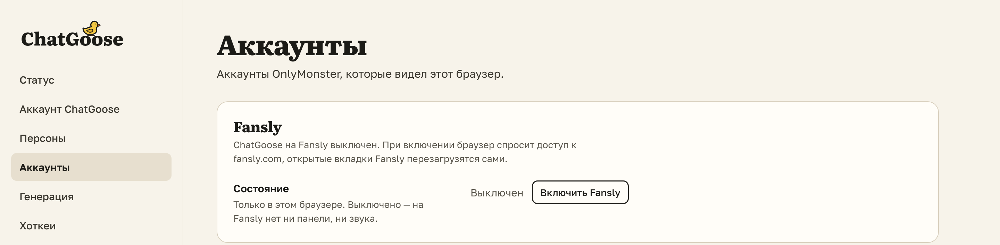

# Старый ChatGoose для Fansly и Desktop больше не обновляются: как перейти

Почти у всех новое расширение уже стоит и обновится до 3.0 само. Если у вас ещё работает старое расширение
для Fansly (2.x):

- Закончите в нём начатые голосовые и загрузки в волт.
- Установите ChatGoose 3.0 с сайта и войдите своим логином.
- Перенесите персоны: в старом «Настройки» → «Персоны» → «Архив локальной персоны» → «Копировать», в новом
  «Настройки» → «Персоны» → «Перенос из старого расширения».
- Удалите старое: ☰ → «Дополнения и темы» → ChatGoose 2.x → «Удалить». В новом нажмите «Включить Fansly».

ChatGoose Desktop больше не нужен: работайте в ChatSpace с расширением, а приложение удалите.

## Как это устроено

Пока старое расширение включено, новое на Fansly молчит, чтобы два расширения не поздоровались с одним фаном
дважды. Firefox не даёт расширению читать данные другого, поэтому персоны переходят через архив, а звук, свои
хоткеи и вид «Заметок» нужно выставить заново. «Включить Fansly» просит у Firefox доступ к fansly.com и
apiv3.fansly.com.
