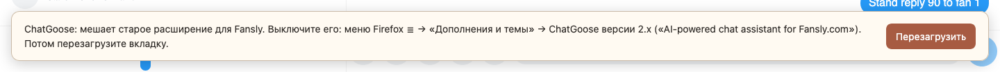
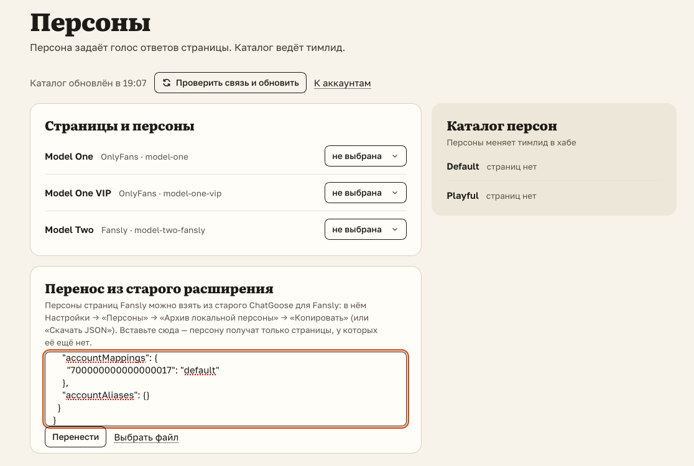

# Переход со старого расширения для Fansly — за несколько минут

Для чаттеров Fansly. Переходите в день, который назначит тимлид: страница переходит целиком, все её
чаттеры сразу.

- Закончите в старом расширении начатые войсы и загрузки в волт.
- Установите ChatGoose 3.0 со страницы установки и войдите своим логином ChatGoose.
- Перенесите персоны. В старом: «Настройки» → «Персоны» → «Архив локальной персоны» → «Копировать».
  В новом: «Настройки» → «Персоны» → «Перенос из старого расширения» → вставьте → «Перенести».
- Выключите старое: меню Firefox ☰ → «Дополнения и темы» → ChatGoose версии 2.x.
- В окне ChatGoose нажмите «Включить Fansly» и разрешите доступ. Открытые вкладки Fansly перезагрузятся сами.

Звук, свои хоткеи и вид «Заметок» выставьте заново.

## Как это устроено

Firefox не даёт одному расширению читать данные другого, поэтому настройки старого не переходят сами:
персоны — через архив, остальное — заново. Пока старое расширение включено, новое на Fansly молчит, чтобы
два расширения не мешали друг другу и не поздоровались с одним фаном дважды. «Включить Fansly» просит у
Firefox доступ к fansly.com и apiv3.fansly.com: без него расширение на Fansly ничего не видит.
Незаконченные войсы и загрузки в волт остаются в старом расширении.
