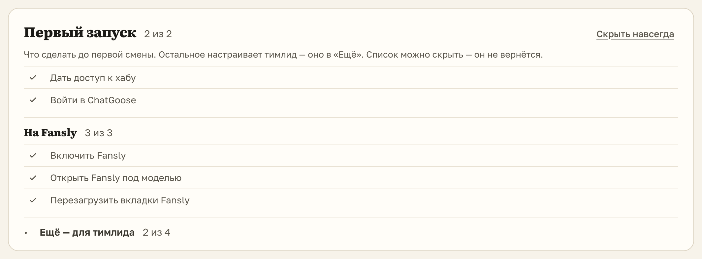

# «Первый запуск» на Fansly больше не просит открыть ChatSpace

Для чаттеров Fansly. В «Настройках» → «Статус» список «Первый запуск» просил «Дать доступ к ChatSpace и хабу» и
«Открыть ChatSpace», хотя на Fansly ChatSpace не нужен. Теперь там «Дать доступ к хабу» и «Войти в ChatGoose», а
ниже три шага Fansly: включить, открыть под моделью, перезагрузить вкладки.

## Как это устроено

Шаги ChatSpace прячутся, когда страницы вашего логина в хабе только на Fansly или Fansly уже включён и открыт, а
ChatSpace в этом браузере не открывался. У тех, кто работает на обоих сайтах, список прежний.
