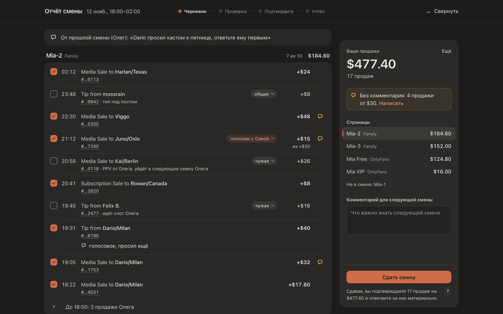

# Окна Workboard поверх сайта в теме сайта

«Записать кастом», «Спросить» и доска «Отчёт» открываются поверх Fansly и ChatSpace, но брали тему компьютера, а не сайта: на светлом компьютере окно открывалось белым поверх тёмного Fansly. Теперь эти окна в той же теме, что сайт и панели ChatGoose: тёмный сайт, тёмные окна; светлый сайт, светлые.

## Как это устроено

ChatGoose задаёт рамке окна тему, в которой сейчас его собственные панели (по умолчанию тему сайта, или ту, что выбрана в настройках ChatGoose), а Firefox передаёт её странице внутри рамки. Сами окна рисует Workboard и берёт эту тему вместо темы компьютера.
