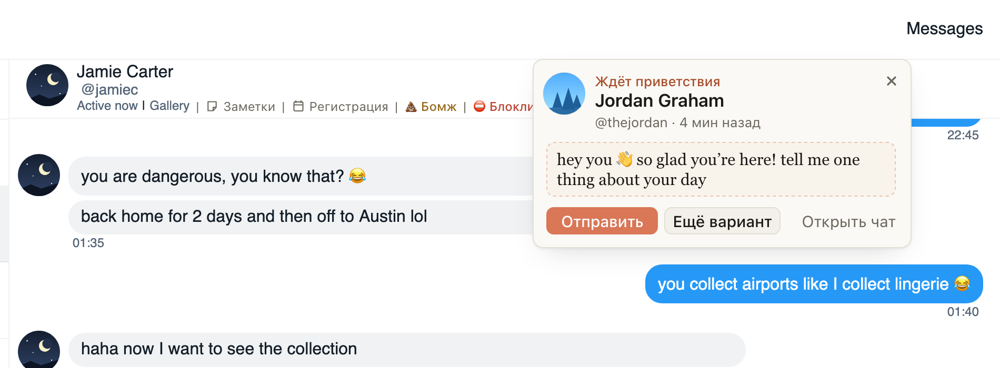

# Hi в «Ждёт приветствия» пишет приветствие прямо в уведомлении, без перехода в чат

Раньше Hi в уведомлении уводил в чат нового фана, и переписка с тем, с кем вы говорили, прерывалась. Теперь вы
остаётесь в своём чате: Hi пишет приветствие прямо в уведомлении, и через пару секунд там появляются текст и кнопки.

- «Отправить»: приветствие уходит фану, как «Отправить» в «Новых».
- «Ещё вариант»: другой текст.
- «Открыть чат»: чат фана с этим текстом в поле, если хочется поправить.

Само ничего не уходит, только по «Отправить». Если фана тем временем поприветствовал кто-то другой, уведомление так и
скажет и ничего не отправит.

## Как это устроено

Приветствие пишется так же, как в карточке фана в «Новых», только карточка не открывается. «Отправить» шлёт его тем же
путём, что «Отправить» в «Новых»: на OnlyFans через очередь отправки ChatSpace, на Fansly из фона расширения. На Fansly
перед этим расширение проверяет чат только этого фана (несколько запросов на чтение), а если чата ещё нет, создаёт его,
как раньше делал Hi. Если чат фана и так открыт у вас на экране, Hi работает по-старому и пишет в поле этого чата. Если
неясно, ушло ли приветствие, уведомление скажет об этом и предложит открыть чат; повторно ничего не отправляется.
