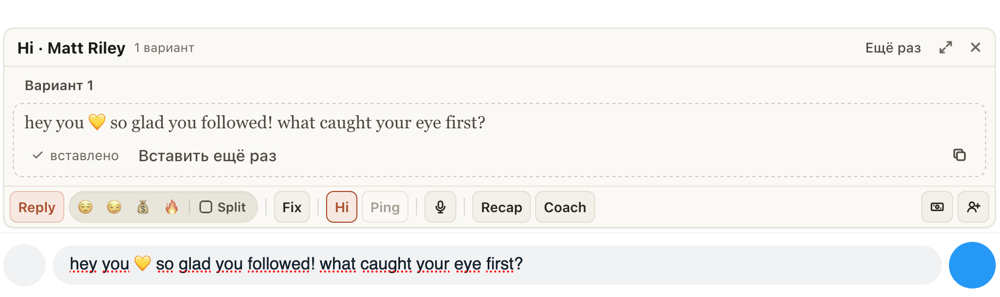

# Hi в «Ждёт приветствия» сразу открывает чат фана

Раньше Hi в уведомлении «Ждёт приветствия» сначала открывал «Новые», ждал, пока расширение проверит фанов, и
только потом писал приветствие: иногда это занимало до минуты. Теперь Hi сразу открывает чат фана, приветствие
пишется там же, над полем ввода, и само встаёт в поле. Остаётся прочитать и отправить: само ничего не уходит.

Если фана тем временем уже поприветствовал кто-то другой, приветствие в поле не попадёт, а уведомление скажет
«Кто-то уже поприветствовал …». Его чат при этом открыт: видно, что ему написали.

## Как это устроено

Hi из уведомления делает то же, что кнопка Hi в чате, только сам: открывает чат фана, просит один вариант
приветствия и вставляет его в пустое поле. Если в поле уже есть ваш текст, расширение спросит, заменить его или
добавить в конец. На Fansly чат нового фоловера, которому ещё никто не писал, создаётся одним запросом от имени
модели, как при открытии фана из Spenders. Пока пишется приветствие, расширение проверяет, не написал ли фану
кто-то из команды (на OnlyFans по списку «Новые», на Fansly по самому чату, автоприветствие модели не считается),
и если написал, останавливает Hi.
