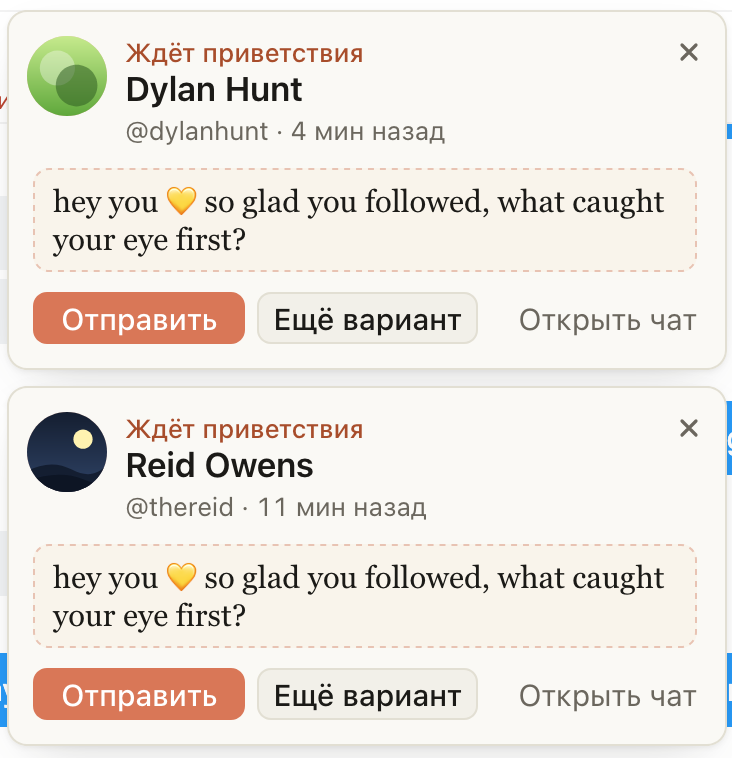

# «Hi» пишет приветствие в каждом напоминании, даже если нажать их подряд

Когда на экране два напоминания «Ждёт приветствия» и вы нажимаете «Hi» в одном, а потом сразу в другом,
приветствие появлялось только в одном из них. Во втором стояло «Не отправлено: Сбой интерфейса», и
приходилось жать «Ещё вариант».

Теперь каждое нажатие пишет своё приветствие: можно нажать «Hi» во всех напоминаниях подряд, не дожидаясь
первого. Отправляет по-прежнему только ваше «Отправить».

## Как это устроено

Генерация из напоминания идёт на разрешение от вашего клика: сначала расширение проверяет фана (на Fansly
это несколько секунд), и только потом просит разрешение на генерацию. Раньше вкладка помнила разрешение
только последнего нажатого «Hi». Второй клик во время проверки первого фана заменял его, и одна из двух
генераций оставалась без разрешения. Теперь у каждого клика своё разрешение: сколько нажатий, столько
приветствий, не больше.
